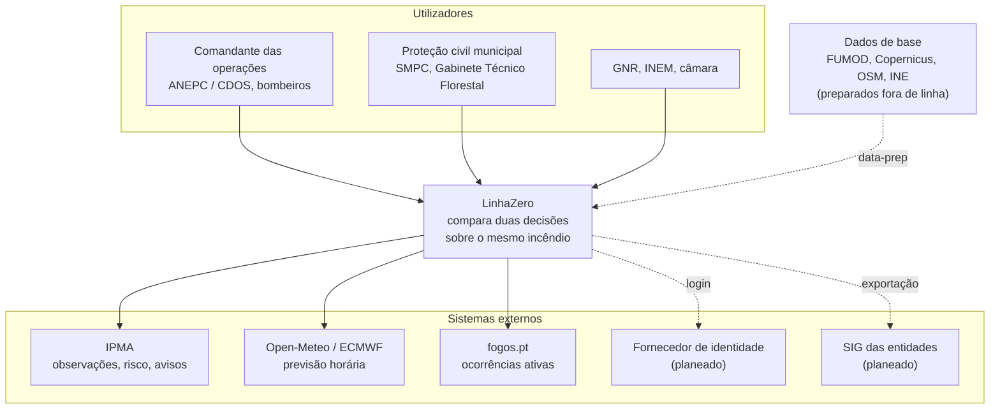

# 3. Contexto e âmbito

Quem usa o LinhaZero, com que sistemas externos fala, e o que fica fora do âmbito.

## Diagrama de contexto (C4, nível 1)

## Interfaces externas

| Sistema | O que dá ou recebe | Estado |
| --- | --- | --- |
| Utilizadores (browser) | Desenham a ignição e as decisões; recebem os mapas e a comparação | Feito |
| Dados de base: FUMOD, Copernicus DEM, OpenStreetMap | Combustível, relevo, barreiras, edifícios e lugares, preparados em grelhas por `data-prep/` | Feito |
| INE (BGRI, Censos 2021) | População por subsecção, para as pessoas expostas | Hackathon |
| IPMA | Observações horárias, risco de incêndio (RCM), avisos | Hackathon |
| Open-Meteo / ECMWF | Vento e humidade previstos, hora a hora | Hackathon |
| fogos.pt | Ocorrências ativas, para pré-preencher a ignição | Hackathon |
| Feed oficial da ANEPC | Ocorrências com garantia de serviço, em vez do fogos.pt | Planeado, por acordo |
| Fornecedor de identidade (Entra ID, Keycloak, Autenticação.gov) | Login dos utilizadores das várias entidades | Planeado |
| SIG das entidades (por exemplo ArcGIS) | Exportação em GeoJSON, KML e Shapefile; serviços OGC API (Features) à escala nacional | Planeado |
| Avisos às populações (CAP, Common Alerting Protocol) | Integração futura | Planeado |
| SADO e FEB Monitorização da ANEPC | Só por acordo com a ANEPC; até lá, usam-se os dados públicos | Planeado, por acordo |

As fontes de dados, com URLs, ritmos de atualização e licenças, estão em [Fontes de dados](../referencia/fontes-de-dados.md).

## Fora do âmbito

- **Substituir o NAD-AIR da ANEPC.** O LinhaZero complementa-o, levando a comparação de decisões aos primeiros minutos e ao nível local (ver [Estado da arte](../estado-da-arte.md)).
- **Previsão operacional validada.** Até o modelo estar calibrado, a ferramenta serve para planeamento e formação.
- **Substituir o julgamento de quem comanda.** É uma segunda opinião rápida, com a incerteza à vista.
