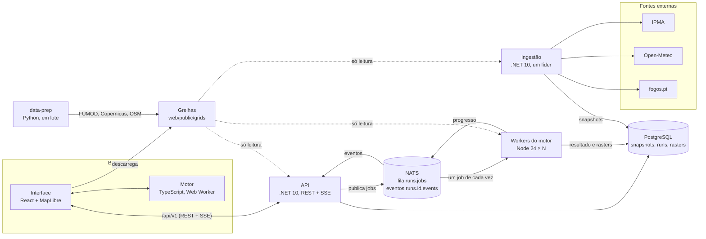

# 5. Vista de blocos

As peças do sistema e, dentro de cada uma, os módulos principais.

## Contentores (C4, nível 2)



| Peça | O que faz | Onde corre | Tecnologia | Estado |
| --- | --- | --- | --- | --- |
| **Interface** | Duas páginas: **Simulação** (mapas, desenho das decisões, comparação, tempo real, ocorrências) e **Editor de grelha** (inspecionar a grelha e fazer variantes) | No browser | React, MapLibre, TypeScript (`web/`) | Feito |
| **Motor** | Propagação do fogo, ensemble, métricas, ficheiros de cenário, variantes, contratos. É uma biblioteca, não um serviço | Num Web Worker da interface e dentro de cada worker do motor | TypeScript (`engine/`) | Feito |
| **API** | Meteorologia e ocorrências a partir dos snapshots; pedidos de corrida (validação, fila), progresso por SSE, resultado e rasters; saúde | Um ou mais contentores, sem estado | .NET 10 (`backend/src/LinhaZero.Api`, `backend/src/LinhaZero.Core`) | Feito |
| **Ingestão** | Recolhe IPMA (observações, avisos, risco, estações, distritos), Open-Meteo e fogos.pt em ciclos fixos; guarda snapshots; apaga os de mais de 3 dias | Um contentor líder; réplicas de reserva à espera do lock | .NET 10 (`backend/src/LinhaZero.Ingest`, `backend/src/LinhaZero.Core`) | Feito |
| **Workers do motor** | Tiram um job de cada vez da fila, correm A e B com o motor, gravam resultado e rasters, publicam o progresso | N contentores, escalam | Node 24 (`engine-worker/`) | Feito |
| **PostgreSQL** | `snapshots`, `source_status`, `runs`, `run_rasters` ([Base de dados](../referencia/base-de-dados.md)) | Um contentor (réplica e PITR planeadas) | PostgreSQL 16 | Feito |
| **NATS** | Fila de trabalho `RUNS` (JetStream) e eventos de progresso (core) | Um contentor | NATS 2.10 | Feito |
| **Preparação de dados** | Gera as grelhas a partir do FUMOD, Copernicus e OSM (e, depois, do INE) | Script, ou a imagem `geo-pipeline` em lote; não é um serviço | Python (`data-prep/`) | Feito |

As grelhas são ficheiros estáticos (ver [Formato da grelha](../referencia/formato-grelha.md)), montados só de leitura na API, nos workers e na ingestão: o browser e o servidor simulam a mesma grelha ([ADR 0032](../decisoes/0032-sem-armazenamento-de-objetos.md)).

## Motor (`engine/src`)

| Módulo | Responsabilidade |
| --- | --- |
| `types.ts` | Contratos de dados do motor: grelha, cenário, intervenções, resultado, métricas |
| `contracts.ts` | Tipos dos contratos entre a interface, a API e os workers: `RunRequest`, `RunResult`, `RunEvent` ([contratos](../../contracts/README.md)) |
| `grid.ts` | Descodificar as camadas binárias, preparar a velocidade base por célula, converter entre metros e células |
| `geometry.ts` | Rasterizar linhas (4-conexas, para o fogo não passar na diagonal) e polígonos |
| `interventions.ts` | Converter as intervenções em camadas por célula (contenção, abrandamento e os seus minutos de início) |
| `spread.ts` | Tempo mínimo de chegada por Dijkstra com 8 vizinhos, vento, declive e intervenções |
| `simulate.ts` | Uma corrida, ou o ensemble de vento com as métricas de cada corrida |
| `metrics.ts` | Área ardida por hora, edifícios, chegada a cada lugar; comparação emparelhada (`comparePaired`) |
| `scenario.ts` | Ler, validar e converter ficheiros de cenário, incluindo a proveniência do vento; usado pela interface, pelos scripts e pelos testes |
| `variant.ts` | Ler, validar e aplicar variantes de grelha (`applyVariant`) e calcular o seu hash ([Formato da variante](../referencia/formato-variante.md)) |
| `hash.ts` | SHA-256 em TypeScript (corre também sem `crypto.subtle`, em páginas HTTP de uma intranet), JSON canónico e o hash de uma grelha (`hashGrid`, [ADR 0043](../decisoes/0043-um-so-hash-de-grelha-hashgrid.md)) |
| `params.ts` | Coeficientes do modelo (provisórios) e fatores das ferramentas; são os valores por omissão de `ModelParams`, uma entrada da simulação que as variantes podem alterar |
| `random.ts`, `heap.ts` | Gerador pseudoaleatório com semente; fila de prioridade do Dijkstra |

## Interface (`web/src`)

| Módulo | Responsabilidade |
| --- | --- |
| `App.tsx` | A página de simulação: grelha, ignição, vento, decisões, variantes de cada decisão, onde corre a incerteza (browser ou servidor), cenários |
| Páginas (`main.tsx`, `lib/route.ts`) | `#/` Simulação e `#/grelha` Editor de grelha, com rotas no endereço (sem biblioteca de rotas), para funcionar como uma só página estática e sem rede |
| `GridEditor.tsx` | O Editor de grelha: ver cada camada (combustível, relevo, lugares), inspecionar cada ponto, pintar combustível, acrescentar ou tirar barreiras, velocidades, coeficientes, guardar, exportar e importar, "Testar na simulação" |
| `components/` | Mapas (`MapView`, com as ocorrências), ferramentas de cada decisão, vento, cartão do tempo real (`WeatherPanel`), inspetor (`CellInspector`), barra de tempo, legenda, painel de comparação |
| `lib/weather.ts` | Meteorologia e ocorrências pela API; texto da idade dos dados |
| `lib/server-run.ts` | Ensemble no servidor: `POST /runs`, SSE, rasters, prazos e volta ao browser |
| `lib/load-grid.ts` | Descarregar grelhas (com o hash) e cenários, e validar cenários contra a grelha |
| `lib/variants.ts` | As variantes guardadas neste browser (`localStorage`), partilhadas pelas duas páginas |
| `lib/render.ts` | Desenhar o mapa de fundo e as camadas da grelha, as camadas do fogo e as células alteradas |
| `lib/projection.ts` | Conversões entre EPSG:3763 e latitude/longitude |
| `lib/sim-client.ts`, `worker/` | Correr o motor num Web Worker sem bloquear a interface (com a variante de cada decisão) |

## Serviços .NET (`backend/`)

Os projetos estão em `backend/src/` e os testes em `backend/tests/`; cada pasta tem o nome do projeto ([ADR 0059](../decisoes/0059-pasta-backend-com-projetos-linhazero.md)). Cada projeto separa as peças por pasta, e a pasta é o namespace (`LinhaZero.Api.Controllers`, `LinhaZero.Core.Weather.Ipma`, ...). As regras de escrita estão em [`backend/README.md`](../../backend/README.md); as decisões nas ADR [0046](../decisoes/0046-api-com-controladores-e-openapi.md) e [0047](../decisoes/0047-clientes-http-tipados-modelos-json-e-dapper.md).

| Projeto | Pasta | Responsabilidade |
| --- | --- | --- |
| `LinhaZero.Core` | `Database/` | Ligação ao PostgreSQL (`Pg`), snapshots e estado das fontes com Dapper (`SnapshotStore`), lock de líder (`LeaderLock`) |
| | `Sources/` | Os nomes das fontes (`SourceCatalog`) e os seus intervalos (`SourceOptions`), o snapshot entregue aos parsers (`Snapshot<T>`), a idade de cada fonte (`SourceStatus`) |
| | `Weather/` | A escolha da meteorologia (`WeatherBuilder`: estação IPMA até 25 km e 3 h, senão o modelo) e os tipos da resposta; em `Ipma/` e `OpenMeteo/`, os ficheiros das fontes como classes C# |
| | `Incidents/` | Leitura das ocorrências (`IncidentParser`); em `Fogos/`, a resposta do fogos.pt como classes C# |
| | `Grids/` | Grelhas montadas (`GridCatalog`, `GridOptions`) e rede de pontos do Open-Meteo (`Lattice`) |
| | `Geo/`, `Json/` | Pontos, caixas e distâncias; leitura tolerante dos ficheiros das fontes (-99 como "sem valor", números em texto) |
| `LinhaZero.Api` | `Controllers/` | Os endpoints `/api/v1`: `Weather`, `Incidents`, `Runs`, `Health` |
| | `Models/` | Corpos dos pedidos e respostas (`RunRequest`, `RunStatusResponse`, `ErrorResponse`, ...) |
| | `Services/` | A lógica de cada endpoint: meteorologia, ocorrências, corridas, eventos SSE, saúde; `SnapshotReader` lê e guarda em cache o snapshot mais recente de cada fonte |
| | `Repositories/` | O SQL das tabelas `runs` e `run_rasters`, com Dapper |
| | `Messaging/` | A fila `RUNS` no NATS e a criação do stream no arranque |
| | `Validation/` | Leitura estrita e validação do pedido de corrida |
| | `OpenApi/` | O esquema do corpo de `POST /runs` no documento OpenAPI |
| `LinhaZero.Ingest` | `Clients/` | Os clientes HTTP tipados `IpmaClient`, `OpenMeteoClient` e `FogosClient` (`IHttpClientFactory`), sem repetições automáticas |
| | `Workers/` | Um ciclo por fonte e a limpeza dos snapshots antigos (`IngestWorker`) |
| | `Services/` | Uma recolha (`Puller`): só guarda o corpo se ele se ler como a classe da fonte; backoff com `Retry-After` guardado em `source_status` |
| `LinhaZero.Tests` | `Core/`, `Api/`, `Ingest/`, `Integration/` | xUnit: parsers e seleção, rede de pontos, URLs e cabeçalhos dos clientes, validação dos pedidos, contratos, respostas HTTP e documento OpenAPI; com `TEST_PG=1`, também PostgreSQL, NATS e failover do líder |

A API publica o documento OpenAPI em `/api/openapi/v1.json` e o Swagger UI em `/api/docs` (http://localhost:3000/api/docs com o compose).

## Workers do motor (`engine-worker/`)

| Módulo | Responsabilidade |
| --- | --- |
| `main.ts` | Ligação ao NATS, ciclo de pull (um job de cada vez), tentativas, SIGTERM, progresso, `/healthz` na porta 9090 |
| `job.ts` | Um job: ler a grelha (com `hashGrid`), aplicar a variante de cada decisão, correr A e B, montar o resultado e os 4 rasters. Sem NATS nem PostgreSQL, para se testar à parte |
| `db.ts` | Linhas de `runs` e `run_rasters`, com escrita idempotente por `runId` |

## Repositório

```text
engine/         motor (TypeScript puro), tipos, cenários, variantes e contratos partilhados, testes
web/            interface React + MapLibre; o motor corre num Web Worker; /api vai para a API
engine-worker/  worker Node que corre o mesmo motor a partir da fila NATS
backend/        .NET 10: src/LinhaZero.{Core,Api,Ingest}, tests/LinhaZero.Tests
contracts/      exemplos JSON dos contratos entre interface, API e worker
infra/          docker-compose, esquema SQL, seed da demo sem rede, smoke.sh
data-prep/      scripts Python que geram web/public/grids/<zona>/ (também em contentor)
docs/           esta documentação
```
