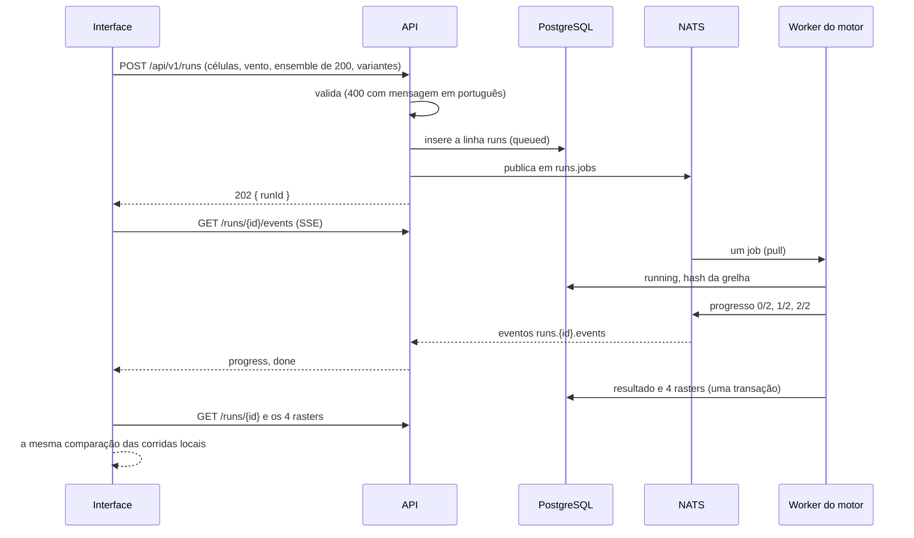
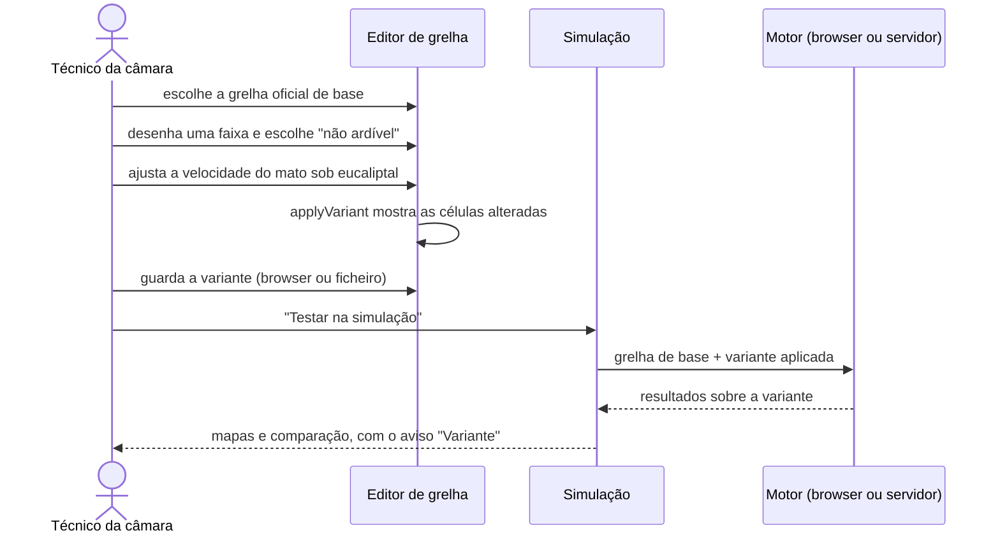

# 6. Vista de execução

O que acontece, passo a passo, nos cenários de uso mais importantes.

## Comparar duas decisões no browser

**Estado:** feito.

```mermaid
sequenceDiagram
  actor U as Utilizador
  participant I as Interface
  participant A as API
  participant M as Motor (Web Worker)

  U->>I: marca a ignição (ou clica numa ocorrência ativa)
  I->>A: GET /api/v1/weather?lat&lon (automático)
  A-->>I: vento, humidade, risco, avisos, próximas horas, idade dos dados
  U->>I: desenha as decisões A e B e carrega em "Simular"
  I->>M: simula A e B (com incerteza, se ligada; cada uma na sua grelha ou variante)
  M-->>I: tempos de chegada, probabilidade, métricas
  I-->>U: dois mapas e a comparação
```

1. O utilizador marca a ignição. Com as ocorrências ativas ligadas, clicar numa delas põe lá a ignição.
2. A interface pede logo à API o tempo para aquele ponto (ao abrir a zona, para o centro; [ADR 0060](../decisoes/0060-tempo-em-direto-por-omissao.md)): a estação IPMA mais próxima com observação válida até 25 km e 3 h, senão o modelo Open-Meteo ([ADR 0027](../decisoes/0027-estacao-ipma-antes-do-modelo-ate-25-km-e-3-h.md)). O cartão mostra a fonte, a idade, a humidade, o risco de incêndio, os avisos e as próximas 8 horas. No modelo de Rothermel, "Do tempo" calcula a humidade do combustível a partir do ar e da nebulosidade. "Seguir a previsão hora a hora" passa as próximas horas ao motor como passos de tempo ([ADR 0050](../decisoes/0050-humidade-do-combustivel-e-tempo-hora-a-hora-no-motor.md)). Cada valor (vento, temperatura, humidade, nuvens, secura do combustível) pode ser mudado à mão e mantém-se quando o tempo se atualiza. Sem a API, o painel diz "sem tempo em direto" e os valores introduzem-se à mão.
3. O utilizador desenha as decisões A e B e carrega em "Simular". O motor corre as duas decisões no browser, com incerteza (30 corridas) se estiver ligada.
4. A interface mostra os mapas e a comparação. Um cenário guardado leva a proveniência do vento enquanto este não for mexido à mão; ao abrir um cenário, o tempo é o do ficheiro até se pedir o de agora.

## Ensemble no servidor

**Estado:** feito. Ver [`contracts/README.md`](../../contracts/README.md) e [`infra/README.md`](../../infra/README.md).



1. Com "Incerteza" ligada e "no servidor (200)" escolhido, a interface constrói os mesmos cenários do motor que usaria no browser (intervenções já em células, fatores das variantes) e envia-os à API, com a variante de grelha de cada decisão ([ADR 0044](../decisoes/0044-variantes-de-grelha-tambem-no-servidor.md)).
2. A API valida o pedido, insere a linha `runs` e publica o job na fila. Com o NATS em baixo responde 503 de imediato, sem deixar nada inserido.
3. Um worker livre tira o job (um de cada vez, [ADR 0039](../decisoes/0039-um-job-de-cada-vez-por-worker.md)), lê a grelha do disco, grava o seu `hashGrid`, verifica e aplica as variantes, corre A e B com as mesmas opções de ensemble e a mesma semente, e grava o resultado e os rasters numa só transação.
4. O progresso chega ao browser por SSE ([ADR 0034](../decisoes/0034-server-sent-events-em-vez-de-signalr.md)). No fim, a interface descarrega o resultado e os rasters, confirma que têm o tamanho da grelha carregada e mostra a comparação pelo mesmo caminho das corridas locais.
5. **Volta ao browser:** se o POST falhar, se nenhum worker começar em 20 s, se não houver resultado em 120 s, ou se a ligação cair sem progresso, a interface corre as 30 corridas no browser e diz porquê. A demonstração nunca fica presa no servidor.
6. **Tolerância a falhas:** um worker que morre a meio deixa o job sem ack; o NATS volta a entregá-lo a outro worker, e ao fim de 3 tentativas a corrida fica `failed`. Uma variante feita para outra versão da grelha falha logo, sem novas tentativas.

## Recolher dados externos

**Estado:** feito. Ver [ADR 0030](../decisoes/0030-ingestao-agendada-com-snapshots-em-postgres.md) e [ADR 0038](../decisoes/0038-ingestao-singleton-com-advisory-lock-numa-ligacao-dedicada.md).

1. Só um processo de ingestão recolhe: cada réplica tenta um advisory lock do PostgreSQL numa ligação dedicada; o líder confirma-o a cada 30 s e, se a ligação falhar, pára e volta a concorrer.
2. O líder corre um ciclo por fonte: observações e avisos do IPMA a cada 10 min, risco a cada hora, estações e distritos a cada 24 h, Open-Meteo a cada 15 min, fogos.pt a cada 2 min.
3. O Open-Meteo pede-se para uma rede fixa de 3 × 3 pontos por grelha; a API responde a um ponto com o ponto da rede mais próximo ([ADR 0037](../decisoes/0037-rede-de-pontos-do-open-meteo-por-dominio.md)).
4. Cada resposta válida fica como uma linha nova de `snapshots`, que nunca se altera; um 429 guarda o `Retry-After` em `source_status`, para que um reinício não insista. Os snapshots com mais de 3 dias apagam-se, guardando sempre o mais recente de cada fonte.
5. A API lê o snapshot mais recente de cada fonte e marca-o como antigo quando passa o dobro do seu intervalo, ou quando o último erro é mais recente do que o último sucesso. A interface mostra a idade real dos dados.
6. **Sem rede:** com `INGEST_OFFLINE=1`, a ingestão não contacta as fontes e a API serve os snapshots carregados de `infra/demo/snapshots.csv`, com a sua idade ("Vento de há 3 dias (sem ligação)", [ADR 0028](../decisoes/0028-cache-em-bruto-e-modo-offline.md)).

## Partilhar um cenário

**Estado:** feito para os cenários em ficheiro e os de demonstração (`?scenario=demo`); com a base de dados e o controlo de acessos, planeado.

1. O cenário guardado tem um URL (`?scenario=<id>`), que só abre para quem tem acesso a esse cenário: a mesma entidade, ou as entidades do incidente.
2. Quem o abre (GNR, INEM, câmara) volta a correr a simulação com as mesmas versões e obtém o mesmo resultado, porque o motor é determinista. Por isso não é preciso guardar os mapas de resultado.
3. Se o hash do resultado não bater certo (outra versão do motor, ou um browser que calcula de forma ligeiramente diferente), a interface avisa.

Hoje, abrir `?scenario=<nome>` lê `web/public/scenarios/<nome>.json`, simula e mostra logo o estado final ([ADR 0013](../decisoes/0013-cenarios-e-scenario.md)).

## Editar uma grelha e testá-la

**Estado:** feito. Ver [ADR 0025](../decisoes/0025-variantes-de-grelha.md) e [Formato da variante](../referencia/formato-variante.md).



1. No Editor de grelha, o utilizador escolhe uma grelha oficial e faz alterações: combustível de uma área, barreiras, velocidades por combustível, coeficientes do modelo. Cada alteração aparece numa lista, com anular, e as células alteradas ficam destacadas.
2. Guarda a variante no browser, ou exporta-a para um ficheiro. A variante tem um hash próprio.
3. "Testar na simulação" abre a página de simulação com a variante escolhida. O menu de grelhas mostra as grelhas oficiais e, à parte, as variantes guardadas.
4. Enquanto uma variante estiver em uso, o título do mapa diz *"Decisão B · variante: Faixa de gestão da Penha"*. O cenário guardado leva a variante dentro do ficheiro; com "no servidor", a variante vai no pedido de corrida.

## Comparar grelhas

**Estado:** feito, no browser e no servidor. O cenário de demonstração `?scenario=faixa` mostra-o pronto.

Para a pergunta da prevenção, *"esta faixa protege a aldeia?"*, a decisão A corre sobre a grelha de base e a decisão B sobre a variante, com a mesma ignição e o mesmo vento. As duas grelhas têm as mesmas dimensões, por isso as métricas comparam-se célula a célula e lugar a lugar. O emparelhamento continua válido, porque a corrida *k* depende só das opções do ensemble e do vento de base ([Incerteza](../modelo/incerteza.md)). No cenário de demonstração, o painel diz *"B poupa 163 edifícios · B é melhor em 30 de 30 cenários"* e *"B impede o fogo de chegar a Souto do Monte"*.
