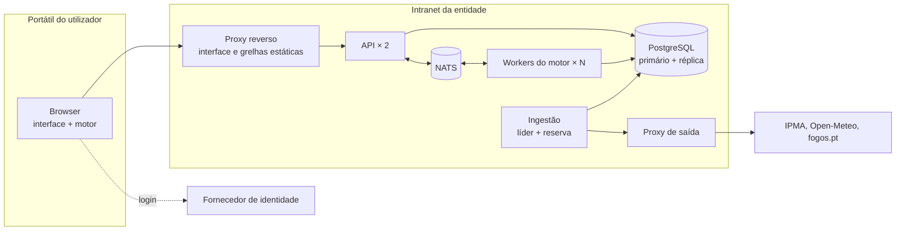

# 7. Vista de implantação

Onde corre cada peça: na demonstração, no desenvolvimento, no piloto, na época de incêndios e numa intranet do Estado. Os comandos, portas e variáveis estão em [`infra/README.md`](../../infra/README.md).

## Diagrama de implantação (época de incêndios)

## Etapas

| Etapa | Como corre | Estado |
| --- | --- | --- |
| Demonstração só no browser | `npm run dev`: tudo no portátil, sem rede e sem Docker | Feito |
| Demonstração com serviços sem rede | `npm run up:offline` com `INGEST_OFFLINE=1` e o seed `infra/demo/snapshots.csv` | Feito |
| Demonstração e desenvolvimento | `docker compose up -d --build` na raiz: interface (nginx), API, ingestão, workers, PostgreSQL e NATS; `npm run dev` para a interface com recarregamento automático | Feito |
| Piloto (uma entidade, planeamento) | O mesmo compose num servidor da entidade, ou PostgreSQL gerido | Planeado |
| Época de incêndios | Como no diagrama: API e workers escalados, ingestão com reserva, réplica e PITR do PostgreSQL | Em parte |

## Disponibilidade

- **Feito:** a API não tem estado e escala (`--scale api=2`); os workers escalam (`--scale engine-worker=N`) e um job de um worker que morre volta à fila; a ingestão tem réplicas de reserva que assumem quando o líder perde o lock; todos os serviços reiniciam sozinhos.
- **Feito no compose:** a interface e as grelhas servidas por um nginx à parte da API ([ADR 0045](../decisoes/0045-um-comando-arranca-tudo-interface-em-contentor.md)), para que uma falha da API não impeça ninguém de abrir os mapas.
- **Planeado:** o mesmo papel num proxy reverso da entidade, com TLS; PostgreSQL com réplica, recuperação para um ponto no tempo (PITR) e testes de reposição, com objetivos de RPO e RTO acordados com as entidades.

## Intranet

- **Saída:** a ingestão é a única peça que sai da intranet, para uma lista fechada de destinos (api.ipma.pt, api.open-meteo.com ou o ECMWF, api.fogos.pt e, depois, o feed da ANEPC), com o proxy de saída e a autoridade de certificação da entidade.
- **Mapa de fundo:** o fundo cartográfico opcional deixa de vir de `tile.openstreetmap.org` e passa a uma fonte interna (PMTiles ou DGT).
- **Instalação sem internet:** cada versão entregue como pacote assinado (imagens, grelhas, manifesto), em vez de npm, Docker Hub ou GitHub no servidor da entidade.
- **Hardware:** o MapLibre precisa de WebGL2; o piloto começa por um levantamento dos portáteis e ambientes VDI.

## Funcionamento sem rede

- **Feito:** o browser simula sozinho; com Docker sem internet, a API serve os snapshots gravados, com a idade real.
- **Planeado:** PWA com as grelhas do distrito em cache e "importar pacote de grelhas" para perfis que apagam a cache.

## Observabilidade

Registos JSON em todos os serviços, `GET /api/v1/health` (PostgreSQL, NATS, workers livres), `/health/ready` da ingestão, `/healthz` dos workers, `infra/smoke.sh` ponta a ponta (feito). Alertas de dados desatualizados e exportação para o SIEM: planeado.

## Soberania e custo

Nada depende de serviços exclusivos de um fornecedor. A carga do servidor cresce com os ensembles pedidos ao servidor, não com o número de utilizadores: as corridas únicas e as de 30 corridas continuam no browser.
