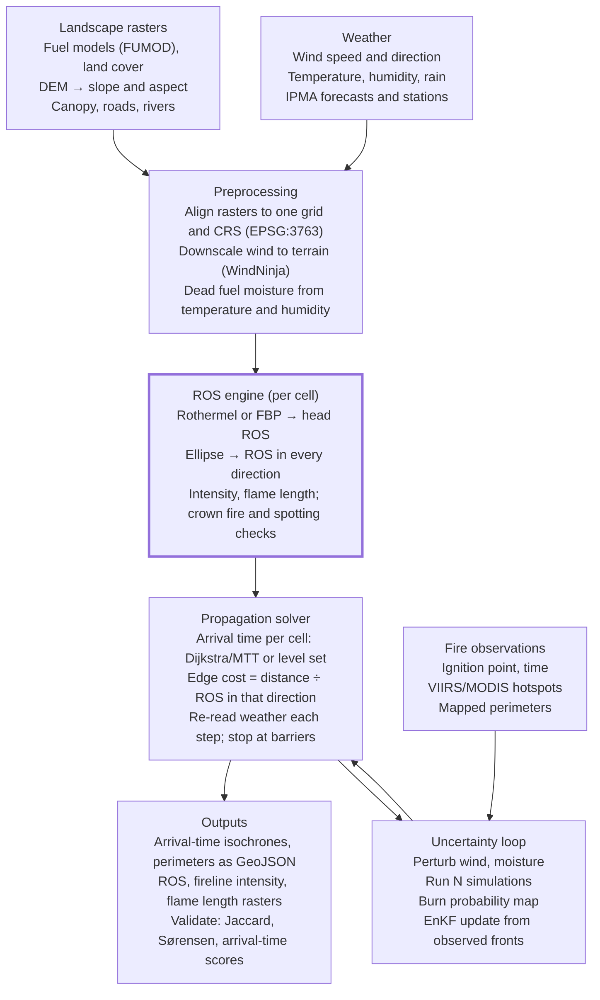

# Simulating Wildfire Propagation: Models, Algorithms and Inputs

Oct 18, 2026 · José

## Summary

The proven recipe for a buildable simulator is two layers: a semi-empirical **rate-of-spread (ROS) model** that answers "how fast does fire move from this cell, in this direction", and a **spatial propagation algorithm** that turns those local speeds into a growing perimeter or an arrival-time map. Almost every operational tool (BehavePlus, FARSITE, FlamMap, ELMFIRE, Cell2Fire, Prometheus) is a variation of that pattern.

- **ROS model:** Rothermel (1972) is the de facto standard; its inputs are fuel load, depth, surface-area-to-volume ratio, heat content, moisture and mineral content, plus wind and slope. The Canadian FBP System is the main alternative.
- **Propagation:** elliptical wave/Huygens (FARSITE), cellular automata (fast, simple), minimum travel time / shortest path (FlamMap MTT), or level-set (ELMFIRE, WRF-SFIRE). For a new codebase, a raster arrival-time solver (Dijkstra-style or level-set) is the best value.
- **Most sensitive inputs:** wind speed and direction, dead fine fuel moisture, fuel model and slope. Get these right before adding crown fire or spotting.
- **Uncertainty is large**, so serious systems run ensembles, output burn-probability and arrival-time maps, and correct themselves with observed perimeters or satellite hotspots (data assimilation).
- **Physics-based CFD** (FIRETEC, WFDS) and coupled fire-atmosphere models (WRF-SFIRE, QUIC-Fire) are research tools; **ML surrogates** are promising but need large training sets.
- **Portugal has the data** to do this: annual fuel-model grids (FUMOD), the COS 2023 land-cover map, the IPMA open-data API and a reconstructed large-fire database (PT-FireSprd) for validation.

## How fire spreads

A fire front advances when the unburned fuel ahead of it is heated to ignition faster than it loses heat. Every model is a way of estimating that heat balance from three groups of drivers, the **fire behaviour triangle**: fuel, weather and topography.

- **Heat transfer:** radiation from flames and embers, convection of hot gases (dominant when wind or slope tilts the flame onto fresh fuel), conduction (minor), and **firebrands** (embers carried ahead to start spot fires).
- **Fire types:** surface fire (litter, grass, shrubs), crown fire (passive torching or active canopy-to-canopy spread) and ground fire (duff, peat). Most models start with surface fire and add crowning and spotting as sub-models.
- **Fire shape:** under steady wind a point ignition grows roughly as an ellipse. The **head** runs downwind/upslope at full ROS, the **flanks** spread sideways and the **back** creeps against the wind. The length-to-breadth ratio grows with wind speed.
- **Feedbacks:** large fires create their own winds (plume-driven fires), which simple models ignore and coupled fire-atmosphere models try to capture.

## Model families

The standard map of the field is Andrew Sullivan's three-part review of surface fire spread models published since 1990 ([part 1](https://arxiv.org/abs/0706.3074), [part 2](https://ar5iv.arxiv.org/html/0706.4128), [part 3](https://arxiv.org/abs/0706.4130); International Journal of Wildland Fire, 2009). It splits models into physical/quasi-physical, empirical/quasi-empirical, and simulation/mathematical-analogue. A physical model represents both the physics and chemistry of spread; a quasi-physical one only the physics. Simulation models mostly take a one-dimensional empirical ROS model and propagate a perimeter across a 2D landscape. Two newer families sit beside these: coupled fire-atmosphere models and machine-learning models.

| Family | What it computes | Examples | Cost | Best for |
| --- | --- | --- | --- | --- |
| Physical (CFD) | Combustion, heat transfer and 3D airflow from first principles | FIRETEC, WFDS | Very high (HPC, slower than real time) | Research, extreme behaviour, fuel-structure effects |
| Quasi-empirical ROS | Steady head-fire ROS from a heat balance calibrated on lab/field data | Rothermel (1972), Canadian FBP, CSIRO grassland, McArthur | Microseconds per call | The local "engine" inside any simulator |
| Simulation (perimeter/raster) | 2D growth driven by an ROS model | FARSITE, Prometheus, FlamMap MTT, ELMFIRE, Cell2Fire | Seconds to minutes | Operational forecasts, risk maps |
| Mathematical analogue | Spread by a mathematical rule rather than physics | Cellular automata, percolation, Finsler-geometry fronts | Very low | Prototypes, teaching, ensembles |
| Coupled fire-atmosphere | Fire spread plus the fire's effect on the wind | WRF-SFIRE, QUIC-Fire, QES-Fire | Medium to high | Large plume-driven fires, prescribed burns |
| Data-driven (ML) | Next-state burn mask learned from data | CNN/ConvLSTM on remote-sensing stacks | Low at inference, high to train | Fast surrogates, day-ahead spread |

## Rate-of-spread sub-models

The ROS model is the heart of the simulator: given the fuel, moisture, wind and slope of one cell, it returns the head-fire speed (m/min), and from that the fire intensity and flame length.

### Rothermel surface fire model

Rothermel's 1972 model ([USDA INT-115](https://www.fs.usda.gov/rm/pubs_int/int_rp115.pdf)) is a heat balance: heat released by the burning front divided by the heat needed to bring the fuel ahead to ignition. [Its required inputs](https://firedoc.nist.gov/article/-XcyXYQBWEcjUZEYtbcB) are fuel loading, fuel depth, particle surface-area-to-volume ratio, heat content, moisture and mineral content, the moisture of extinction, mean wind speed and terrain slope. It also introduced the **fuel model** concept: tabulated parameter sets so fuels need not be measured every time.

$$
R = \frac{I_R \, \xi \, (1 + \phi_w + \phi_s)}{\rho_b \, \varepsilon \, Q_{ig}}
$$

- I_R reaction intensity (kW/m²), ξ propagating flux ratio — together the heat source.
- φ_w wind factor (grows as a power of midflame wind speed), φ_s slope factor (proportional to tan² of the slope angle).
- ρ_b ovendry bulk density, ε effective heating number, Q_ig heat of pre-ignition (rises with fuel moisture) — together the heat sink.

The best single reference for implementers is Patricia Andrews' [RMRS-GTR-371 (2018)](https://research.fs.usda.gov/treesearch/55928), which consolidates every Rothermel equation, the Albini (1976) adjustments, dynamic live-fuel curing, cross-slope wind and spread in non-head directions in one document. Standard parameter sets are Anderson's 13 fuel models (1982) and Scott and Burgan's 40 (2005).

Two derived outputs matter operationally: Byram's fireline intensity I = H·w·R (heat yield × fuel consumed × ROS, kW/m) and flame length, which drive suppression decisions and crown-fire initiation.

### Fire shape around the head

To spread in 2D you need ROS in every direction, not just the head. The common approach is Anderson's (1983) ellipse: a length-to-breadth ratio computed from midflame wind gives the eccentricity, flank and back ROS follow from it, and the ignition point sits at the rear focus. FARSITE, Prometheus and Cell2Fire all use this idea. [Recent work](https://arxiv.org/html/2110.03364v4) generalises it to non-elliptical shapes with Finsler geometry, useful when wind and slope point in different directions.

### Canadian FBP and FWI systems

The Canadian alternative is fully empirical. The [FWI System](https://cran.r-project.org/web/packages/cffdrs/refman/cffdrs.html) turns daily weather into three fuel moisture codes (FFMC, DMC, DC) and three behaviour indices (ISI, BUI, FWI). The FBP System adds fuel type and slope to predict ROS, consumption and intensity. Cell2Fire and Prometheus are built on it, and the FWI is widely used in Europe for danger rating.

### Crown fire

- **Initiation:** Van Wagner (1977) — crowning starts when surface intensity exceeds a threshold set by canopy base height and foliar moisture.
- **Active crown spread:** Rothermel (1991) or Cruz et al. (2005). The Cruz-Alexander [CFIS system](https://www.frames.gov/catalog/46217) needs only 10-m open wind speed, estimated fine fuel moisture and canopy bulk density.
- **Caveat:** Cruz and Alexander [showed that systems linking Rothermel with Van Wagner](https://bnhcrc.com.au/node/777) (FARSITE, FlamMap, BehavePlus, NEXUS) significantly underpredict crown fire behaviour in conifer forests, due to incompatible model links, biased spread models and unsupported crown-fraction-burned functions.

### Spotting (firebrands)

Albini's models estimate maximum spotting distance from [burning trees (1979)](https://www.frames.gov/catalog/8153), surface fires (1983) and [active crown fires (2012)](https://publish.csiro.au/WF/WF11020): lofting height scales with the plume's strength, and drift scales with wind speed. Simulators typically turn this into a stochastic process: sample ember landing points downwind and ignite them with some probability. Spotting matters a lot in eucalyptus and pine landscapes like Portugal's.

### Mediterranean and Portuguese fuels

Standard US fuel models fit Mediterranean shrublands poorly. Custom models — including [national sets for Portugal](https://www.afs-journal.org/10.1051/forest/2009013) by Cruz (2005) and Cruz and Fernandes (2008), and shrub-specific spread work by Fernandes (2001) — [measurably improve simulation accuracy](https://pmc.ncbi.nlm.nih.gov/articles/PMC10244702). The Portuguese set is grouped into F (litter), M (litter plus understory) and V (shrub or grass) models.

## Propagation algorithms

The propagation layer decides how local ROS values become a landscape-scale fire. [Pais et al.](https://arxiv.org/pdf/1905.09317) note that wave propagation and cellular automata are the two methods most often used; minimum travel time, level-set and learned models complete the set.

| Algorithm | Core idea | Strengths | Weaknesses | Used in |
| --- | --- | --- | --- | --- |
| Elliptical wave (Huygens) | Each perimeter vertex spawns a small ellipse per time step; the new perimeter is their envelope (Richards 1990 equations) | Accurate shapes, smooth perimeters, time-varying weather | Vertex tangles and loops must be cleaned; merging fires is hard | FARSITE, Prometheus |
| Cellular automata (CA) | Grid cells move between unburned, burning and burned by deterministic or probabilistic neighbour rules | Very simple, parallel, GPU-friendly, easy to add barriers | Grid-shaped fire fronts; time is not physical unless ROS-driven | Alexandridis (2008), PROPAGATOR, PyTorchFire, Cell2Fire (hybrid) |
| Minimum travel time (MTT) | Shortest-path search for the fastest route from ignition to every node | Fast, no perimeter bookkeeping, great for thousands of ignitions | Weather and moisture held constant during a run | FlamMap MTT, FSim, FSPro |
| Level set | Front = zero contour of a field φ, advanced with φ_t + R·‖∇φ‖ = 0 | Natural merging and splitting, sub-cell accuracy, couples to weather models | Needs careful numerics | ELMFIRE, WRF-SFIRE, ForeFire |
| Coupled fire-atmosphere | Fire heat changes the wind, which changes the fire | Captures plume-driven behaviour | Heavy compute, many parameters | WRF-SFIRE, QUIC-Fire, FIRETEC |
| Machine learning | Network maps today's fire and drivers to tomorrow's mask | Milliseconds per forecast | Needs lots of labelled fires; weak extrapolation | Next Day Wildfire Spread models |

### Elliptical wave propagation

In [FARSITE](https://owfflammaphelp62.firenet.gov/LegacyFARSITE/Tech_Modeling_Fire_Growth.htm), the fire environment at each perimeter point sizes and orients an ellipse every time step. Finney's [RMRS-RP-4](https://www.fs.usda.gov/rm/pubs/rmrs_rp004.pdf) describes the model; its [documentation](https://owfflammaphelp62.firenet.gov/LegacyFARSITE/Tech_Limitations_and_Assumptions.htm) notes that errors compound with time and distance, and that the method is validated mostly under simple conditions.

### Cellular automata

The most-cited stochastic CA is [Alexandridis et al. (2008)](https://dspace.lib.ntua.gr/xmlui/handle/123456789/18520), tuned on the 1990 Spetses Island fire. A burning cell ignites a neighbour with [probability](https://arxiv.org/pdf/2507.00761):

$$
p_{burn} = p_h \, (1 + p_{veg}) \, (1 + p_{den}) \, p_w \, p_s
$$

where p_h is a base probability and the factors capture vegetation type, density, wind (an exponential of speed and of the angle between wind and spread direction) and slope. The same group later applied it to the 2007 Parnitha fire, adding spotting and suppression. Main pitfall: on a 4- or 8-neighbour grid fires grow as squares or octagons; use 16-neighbour stencils, random perturbations or ROS-driven travel times to break the grid bias.

### Minimum travel time

Finney's MTT (2002) [searches for the set of pathways with minimum spread time](https://owfflammaphelp62.firenet.gov/Tech_Topics/Tech_MTT.htm) between cell-corner nodes. In theory it matches FARSITE's wave expansion, except that weather and fuel moisture stay constant. It is effectively Dijkstra's algorithm with direction-dependent edge costs (distance ÷ ROS in that direction), which makes it the easiest accurate option for a software engineer. It also produces burn-probability maps from many random ignitions.

### Level set

The front is the zero contour of a signed-distance field; ELMFIRE and WRF-SFIRE use this. Numerics matter: a [high-order WRF-Fire study](https://data.ucar.edu/dataset/an-accurate-fire-spread-algorithm-in-the-weather-research-and-forecasting-model-using-the-level) found the common implementation gives 10–35% ROS errors at 12.5–100 m grids and underestimates area, while a fifth-order WENO scheme with third-order Runge-Kutta cut errors below 1%.

### Coupled and physics-based models

[WRF-SFIRE](https://gmd.copernicus.org/articles/4/591/2011/gmd-4-591-2011.html) passes surface wind to a level-set fire model and returns heat flux to the atmosphere each step, running faster than real time on a cluster. [QUIC-Fire](https://www.frames.gov/catalog/60612) couples a fast 3D wind solver to a physics-based CA and agrees closely with FIRETEC at a fraction of the cost. FIRETEC and WFDS solve the full CFD problem and remain research tools.

### Machine learning

The [Jain et al. (2020) review](https://arxiv.org/abs/2003.00646v2) covers ML across six wildfire domains, including behaviour prediction. Google's [Next Day Wildfire Spread](https://arxiv.org/pdf/2112.02447) dataset is the common benchmark: [about 18,500 1-km samples](https://arxiv.org/pdf/2609.17763) stacking elevation, NDVI, six weather fields, drought, ERC, population and the previous day's fire mask. A good hybrid pattern is to train a neural surrogate on your own physics simulator's outputs to get fast ensembles.

## Parameters and variables

Wind, dead fine fuel moisture, fuel model and slope dominate ROS; canopy variables only matter once you model crown fire. Store every spatial input as an aligned raster (same CRS, extent and cell size) and every temporal input as a time series.

| Group | Variable | Units | Why it matters | Typical source |
| --- | --- | --- | --- | --- |
| Fuel | Fuel model (class per cell) | category | Selects the full Rothermel parameter set | Fuel-model map (FUMOD in Portugal), or land cover reclassified |
| Fuel | Fuel load by size class (1-h, 10-h, 100-h dead; live herb, live woody) | kg/m² | Energy available; fine fuels carry the front | Fuel model table |
| Fuel | Fuel bed depth | m | Sets packing ratio and bulk density | Fuel model table |
| Fuel | Surface-area-to-volume ratio | 1/m | Fine particles heat and ignite faster | Fuel model table |
| Fuel | Heat content | kJ/kg | Heat released per kg burned (≈18,600 standard) | Fuel model table |
| Fuel | Mineral content (total, effective) | fraction | Damps combustion | Constants (0.0555, 0.010) |
| Fuel | Moisture of extinction | fraction | Moisture above which fire will not spread | Fuel model table |
| Moisture | Dead fuel moisture (1-h, 10-h, 100-h) | % | Single strongest weather-driven control on ROS | Derived from temperature, RH, shading, recent rain; FFMC as proxy |
| Moisture | Live herbaceous and woody moisture | % | Live shrubs act as a heat sink until cured | Seasonal values, satellite indices (NDVI, NDWI) |
| Moisture | Foliar moisture content | % | Controls crown-fire initiation | Seasonal constant (≈90–120%) |
| Weather | Wind speed (10-m) and midflame wind | m/s | Tilts flames onto fuel; exponential effect on ROS | Forecast or stations, reduced with a wind adjustment factor |
| Weather | Wind direction | degrees | Orients the fire ellipse | Forecast or stations; WindNinja downscaling in complex terrain |
| Weather | Air temperature, relative humidity | °C, % | Drive dead fuel moisture over hours | Stations, forecast |
| Weather | Precipitation, drought indices (DC, KBDI) | mm, index | Long-term dryness of heavier fuels | FWI system, reanalysis |
| Topography | Elevation | m | Base for slope, aspect and wind modelling | DEM |
| Topography | Slope | degrees | Upslope fire preheats fuel; ROS ∝ tan² | Derived from DEM |
| Topography | Aspect | degrees | Direction of slope effect; sun exposure affects moisture | Derived from DEM |
| Canopy | Canopy cover | % | Shelters surface fuels from wind and sun | Forest inventory, LiDAR |
| Canopy | Canopy height and base height | m | Base height controls torching | LiDAR, inventory |
| Canopy | Canopy bulk density | kg/m³ | Controls active crown-fire spread | LiDAR, inventory |
| Barriers | Roads, rivers, firebreaks, urban areas | mask | Stop or slow the fire | OSM, land cover |
| Ignition | Location and time | point/polygon, timestamp | Starting condition | Reports, satellite hotspots |
| Suppression | Fire lines, aerial drops (optional) | mask over time | Changes the outcome of real fires | Operations logs |
| Model | ROS adjustment factors per fuel | multiplier | Calibration knobs | Fitted to past fires |
| Model | Grid cell size, time step | m, min | Accuracy versus speed | Your choice (10–30 m, CFL-limited step) |

**Core outputs:** arrival time per cell, ROS (head, flank, back), fireline intensity (kW/m), flame length (m), fire type (surface/passive/active crown), and across an ensemble, burn probability.

## Software architecture

A simulator is a data pipeline wrapped around one small, well-tested function: the per-cell ROS engine. Keep that engine pure (inputs in, ROS out) so it can be unit-tested against BehavePlus values and reused by any solver.



Observations do not drive spread directly; they enter through the uncertainty loop, which perturbs inputs, runs many simulations and corrects the front.

### Core data structures

- **Landscape stack:** aligned 2D arrays (float32) for fuel model, slope, aspect, canopy and a burnable mask; one grid definition (origin, cell size, CRS).
- **Fuel table:** fuel model id → Rothermel parameters (loads, SAV, depth, moisture of extinction, heat content).
- **Weather cube:** time-indexed grids or station series, interpolated to cells; precompute dead fuel moisture per time step.
- **Fire state:** arrival-time grid (inf = unburned), plus optional ROS, intensity and fire-type grids; a priority queue of candidate ignitions.

### Solver sketch (Dijkstra / MTT style)

```python
arrival = full(shape, inf)
heap = []
for c in ignitions:
    arrival[c] = t0
    heappush(heap, (t0, c))

while heap:
    t, c = heappop(heap)
    if t > arrival[c] or t > t_end:
        continue
    wx = weather.at(t, c)                    # wind, dead fuel moisture now
    head, dir_max, lb = ros_engine(fuel[c], wx, slope[c], aspect[c])
    for n, dist, bearing in neighbours16(c):  # 16 directions limit grid bias
        if not burnable[n]:
            continue
        r = ellipse_ros(head, dir_max, lb, bearing)
        t_new = t + dist / max(r, 1e-6)
        if t_new < arrival[n]:
            arrival[n] = t_new
            heappush(heap, (t_new, n))
    # optional: crown-fire check, then sample ember landings
    # and push them with an ignition delay
```

This is O(N log N) in cells, so a 30 m grid over 900 km² (1 million cells) runs in seconds in Numba, Rust, C++ or C#. Ensembles parallelise trivially: one run per core. For time-varying weather beyond hours, re-run from the current front at each weather update, or move to a level-set solver.

## Calibration, uncertainty and validation

A deterministic run gives one perimeter that is almost certainly wrong in detail; the useful product is a probability map that is corrected as observations arrive.

- **Calibrate:** fit per-fuel ROS adjustment factors on past fires. Cell2Fire's authors [tune head, flank and back ROS multipliers with derivative-free optimisation](https://arxiv.org/pdf/1909.05949); Alexandridis tuned CA parameters with black-box optimisation against the Spetses fire.
- **Ensembles:** perturb wind, moisture and ignition time, run tens to thousands of simulations, and report burn probability and arrival-time percentiles. In Portugal, [Benali et al.](https://pmc.ncbi.nlm.nih.gov/articles/PMC4965362) ran probabilistic FARSITE forecasts on the 2012 Tavira fire and showed that [initialising from MODIS/VIIRS active-fire points](https://dl.uc.pt/handle/10316.2/34307) improved arrival-time predictions.
- **Data assimilation:** an Ensemble Kalman Filter can [correct the simulated perimeter from noisy observed perimeters](https://wifire.ucsd.edu/node/62) and [also update fuel adjustment factors](https://wifire.ucsd.edu/node/69) over time; the [ETKF variant](https://www.frames.gov/catalog/57436) was more accurate than EnKF for the same ensemble size. Particle filters and newer score-based filters ([Fire-EnSF](https://arxiv.org/pdf/2510.15954v1)) are alternatives.

**Validation metrics** compare simulated and observed burned areas or fronts:

| Metric | Formula / idea | Reads as |
| --- | --- | --- |
| Jaccard (IoU) | TP / (TP + FP + FN) | Overlap of burned areas, 1 = perfect |
| Sørensen (Dice, F1) | 2TP / (2TP + FP + FN) | Overlap, more forgiving than Jaccard |
| Cohen's kappa | Agreement corrected for chance | Useful when burned area is small vs domain |
| Hausdorff distance | Largest gap between simulated and observed fronts | Worst-case front position error (m) |
| Arrival-time agreement | Compares when each cell burned, not just whether | Scores the dynamics, not just the final scar |

[Filippi, Mallet and Nader (2014)](https://www.publish.csiro.au/WF/fulltext/WF12202) argue that snapshot overlap scores miss the dynamics and propose arrival-time and shape agreement scores; no single number captures simulation error. [Kelso et al.](https://research-repository.uwa.edu.au/en/publications/techniques-for-evaluating-wildfire-simulators-via-the-simulation-/) found accuracy drops in extreme fire danger, with head-fire ROS underpredicted — a pattern to expect in your own tests.

## Data sources for Portugal

Mainland Portugal has open data for every input layer; the fuel-model grid is the most valuable and hardest to replicate.

| Layer | Dataset | Notes |
| --- | --- | --- |
| Fuel models | [FUMOD annual fuel-model grids](https://repositorio.ulisboa.pt/jspui/handle/10400.5/29300) (Sá, Benali, Fernandes et al., 2023) | Used for national grids since 2019 for risk and suppression support; data and tools on [GitHub](https://github.com/anasa30/PT_FuelModels); also listed in the [ICNF geocatalogue](https://geocatalogo.icnf.pt/catalogo_tema5.html) |
| Land cover | [COS — Carta de Uso e Ocupação do Solo](https://smos.dgterritorio.gov.pt/sites/default/files/documents/Ficha_de_produto_COS_v29-07-2025_1.pdf) (DGT) | Open data; 2023 edition starts a new series; already used for rural-fire hazard mapping. COSc gives yearly Sentinel-2-based updates |
| Weather (forecast, observations) | [IPMA open-data API](https://api.ipma.pt/) | No key; daily forecasts by location, fire-risk forecast, and [hourly observations from about 222 stations](https://wetterdienst.readthedocs.io/en/latest/_sources/data/provider/ipma/observation/index.md) (rolling last ~24 h only, so archive it yourself) |
| Validation fires | [PT-FireSprd](https://repositorio.ulisboa.pt/entities/publication/3ef30d83-3914-4630-9f83-b377897949cc/full) (Benali et al.) | Reconstructed spread of 80 large Portuguese fires, 2015–2021; on [Zenodo](https://doi.org/10.5281/zenodo.7495506) |
| Active fires | MODIS / VIIRS hotspots (NASA FIRMS) | Ignition and assimilation input; used in Portuguese FARSITE studies |
| Elevation | A national or Copernicus DEM (≈25–30 m) | Slope, aspect, wind downscaling |

In the Portuguese research community, the ISA/University of Lisbon group (Benali, Sá, Pereira) works with the national civil protection authority (ANEPC) on operational spread forecasts, and UTAD (Fernandes) leads fuel and fire behaviour research — both natural partners or reviewers for a local project.

## Open-source tools to reuse

You do not need to write the fire physics from scratch: reuse a tested ROS library and focus your effort on data plumbing, propagation and the user-facing product.

| Tool | Language | What it gives you | Notes |
| --- | --- | --- | --- |
| [pyretechnics](https://pypi.org/project/pyretechnics) | Python | The [fundamental equations](https://ost.ecosyste.ms/projects/351112) behind GridFire, ELMFIRE, FlamMap, FARSITE and BehavePlus, scriptable | EPL-2.0; good base for a custom simulator |
| [pyrothermel](https://pypi.org/project/pyrothermel/) | Python over C++ | Bindings to the Behave C++ code: surface and crown ROS, intensity, torching and crowning indices | Early-stage API |
| [ELMFIRE](https://github.com/lautenberger/elmfire) | Fortran | Operational level-set simulator: Rothermel, crown fire, ember spotting, burn probability | EPL-2.0; forecasts most large US fires via [Pyrecast](https://ost.ecosyste.ms/projects/175594) |
| [Cell2Fire](https://github.com/cell2fire/Cell2Fire) | C++ / Python | Cell-based elliptical spread with FBP, parallel, validated against Prometheus | Good architecture reference |
| [FlamMap / FARSITE](https://firelab.org/node/164) | Windows desktop | Reference outputs (MTT, FARSITE, burn probability) to check your own code | Free; Windows 64-bit only |
| [WindNinja](https://acp.copernicus.org/articles/16/5229/2016/) | C++ | Mass-conserving terrain wind downscaling from weather forecasts | Important in hilly terrain like the Minho |
| [cffdrs](https://cran.r-project.org/web/packages/cffdrs/refman/cffdrs.html) | R | Canadian FWI and FBP systems, including raster versions | FWI codes as moisture proxies |
| [PyTorchFire](https://pytorchfire.readthedocs.io/stable/reference/model/) | Python / PyTorch | Alexandridis-style CA on GPU, differentiable for parameter fitting | Quick CA baseline |
| [WRF-SFIRE](https://gmd.copernicus.org/articles/4/591/2011/gmd-4-591-2011.html) | Fortran | Coupled weather + level-set fire | Research and HPC only |

For a .NET stack, the numerically heavy core can live in a Python or C++ service, or be ported to C# from the Andrews GTR-371 equations (a few hundred lines) with GDAL bindings for raster I/O.

## Build path

Start with a credible minimum (Rothermel + shortest-path arrival time on real Portuguese rasters) and add realism in layers; each stage is usable on its own.

1. **Prototype (a few days).** One study area, 20–30 m grid. Fuel models from FUMOD, slope from a DEM, constant wind and moisture scenario. Rothermel ROS via pyretechnics or pyrothermel, elliptical directional ROS, Dijkstra arrival-time solver on a 16-neighbour stencil. Output isochrones every 30–60 min on a web map. Sanity-check a few cells against BehavePlus/FlamMap.
2. **Time-varying conditions (1–2 weeks).** Hourly wind and humidity from IPMA, dead fuel moisture from temperature and RH, WindNinja-downscaled wind, barriers from roads and rivers. Switch to an event-driven or level-set solver so weather can change mid-run.
3. **Extreme behaviour.** Crown-fire initiation and spread (Van Wagner, Cruz et al.), stochastic spotting (Albini-based distance distribution). Expect crown fire to be underpredicted if you chain Rothermel and Van Wagner naively.
4. **Probabilistic forecasts.** Ensembles over wind, moisture and ignition uncertainty; burn-probability and arrival-time percentile maps; calibration of ROS factors against PT-FireSprd fires; Jaccard/Sørensen and arrival-time scores.
5. **Live correction.** Ingest VIIRS/MODIS hotspots and observed perimeters; re-initialise or run an EnKF to update the front and ROS factors.
6. **Speed-up (optional).** Train a CNN/ConvLSTM surrogate on thousands of your own simulations for near-instant what-if scenarios.

**Common pitfalls:**

- Unit mix-ups (Rothermel's original equations are in imperial units; ELMFIRE users list unit mismatches as the most dangerous error).
- Using 10-m wind directly as midflame wind — apply a wind adjustment factor (roughly 0.1–0.5 depending on canopy).
- Grid-shaped fires from 4- or 8-neighbour stencils.
- Mixing CRSs; in mainland Portugal use ETRS89 / PT-TM06 (EPSG:3763) throughout.
- Presenting a single deterministic perimeter to decision-makers as if it were certain.

## Key references

**Reviews**

- Sullivan, A.L. (2009). Wildland surface fire spread modelling, 1990–2007, parts [1](https://arxiv.org/abs/0706.3074), [2](https://publish.csiro.au/WF/WF06142), [3](https://www.publish.csiro.au/WF/WF06144). International Journal of Wildland Fire 18(4).
- Jain, P. et al. (2020). [A review of machine learning applications in wildfire science and management](https://arxiv.org/abs/2003.00646v2). Environmental Reviews.

**Rate of spread, crown fire, spotting**

- Rothermel, R.C. (1972). [A mathematical model for predicting fire spread in wildland fuels](https://www.fs.usda.gov/rm/pubs_int/int_rp115.pdf). USDA INT-115.
- Andrews, P.L. (2018). [The Rothermel surface fire spread model and associated developments](https://research.fs.usda.gov/treesearch/55928). RMRS-GTR-371.
- Cruz, M.G., Alexander, M.E., Wakimoto, R.H. (2005). [Development and testing of models for predicting crown fire rate of spread](https://victoriasforestryheritage.org.au/pinefire/Cruz_etal_2005_DevelopmentAndTestingOfModelsForPredictingCrownFireRateOfSpread.pdf).
- Cruz, M.G., Alexander, M.E. (2010). [Assessing crown fire potential in coniferous forests: a critique](https://bnhcrc.com.au/node/777).
- Albini, F.A. (1979). [Spot fire distance from burning trees](https://www.frames.gov/catalog/8153); Albini, Alexander, Cruz (2012). [Maximum spotting distance from a crown fire](https://publish.csiro.au/WF/WF11020).
- Van Wagner, C.E. (1987). Canadian Forest Fire Weather Index System — via [cffdrs](https://cran.r-project.org/web/packages/cffdrs/refman/cffdrs.html).

**Propagation and simulators**

- Finney, M.A. (1998). [FARSITE: Fire Area Simulator](https://www.fs.usda.gov/rm/pubs/rmrs_rp004.pdf). RMRS-RP-4.
- Finney, M.A. (2002). Fire growth using minimum travel time methods — [FlamMap MTT documentation](https://owfflammaphelp62.firenet.gov/Tech_Topics/Tech_MTT.htm).
- Alexandridis, A. et al. (2008). [A cellular automata model for forest fire spread prediction: Spetses 1990](https://dspace.lib.ntua.gr/xmlui/handle/123456789/18520).
- Pais, C. et al. (2019). [Cell2Fire: a cell-based forest fire growth model](https://arxiv.org/pdf/1905.09317).
- Mandel, J. et al. (2011). [Coupled atmosphere-wildland fire modeling with WRF 3.3 and SFIRE](https://gmd.copernicus.org/articles/4/591/2011/gmd-4-591-2011.html).
- [An accurate fire-spread algorithm in WRF using the level-set method](https://data.ucar.edu/dataset/an-accurate-fire-spread-algorithm-in-the-weather-research-and-forecasting-model-using-the-level).
- Linn, R.R. et al. (2020). [QUIC-Fire: a fast-running simulation tool](https://www.frames.gov/catalog/60612).
- Javaloyes, M.A. et al. [A general model for wildfire propagation with wind and slope](https://arxiv.org/html/2110.03364v4) (Finsler geometry).
- Forthofer et al. / Wagenbrenner et al. (2016). [Downscaling surface wind with WindNinja](https://acp.copernicus.org/articles/16/5229/2016/).

**Data, assimilation, validation**

- Huot, F. et al. (2022). [Next Day Wildfire Spread dataset](https://arxiv.org/pdf/2112.02447).
- Srivas, T. et al. (2016). [Wildfire spread prediction and assimilation for FARSITE using EnKF](https://wifire.ucsd.edu/node/62).
- Filippi, J.-B., Mallet, V., Nader, B. (2014). [Representation and evaluation of wildfire propagation simulations](https://www.publish.csiro.au/WF/fulltext/WF12202).

**Portugal**

- Fernandes, P.M. (2009). [Combining forest structure data and fuel modelling to classify fire hazard in Portugal](https://www.afs-journal.org/10.1051/forest/2009013).
- Sá, A.C.L. et al. (2023). [FUMOD: a flexible and customized fuel models dataset](https://pmc.ncbi.nlm.nih.gov/articles/PMC10244702).
- Benali, A. et al. (2016). [Probabilistic fire spread forecast as a management tool in an operational setting](https://pmc.ncbi.nlm.nih.gov/articles/PMC4965362).
- Benali, A. et al. (2023). [The Portuguese Large Wildfire Spread database (PT-FireSprd)](https://repositorio.ulisboa.pt/entities/publication/3ef30d83-3914-4630-9f83-b377897949cc/full).
