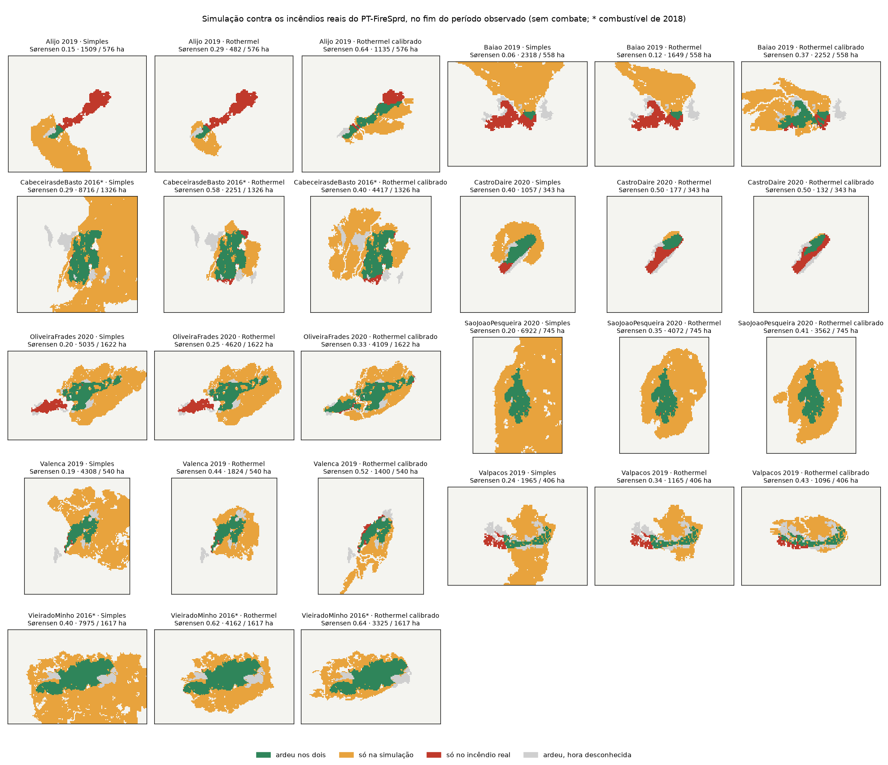

# Calibração e validação

Como sabemos que o motor faz o que dizemos, e como o vamos aproximar dos incêndios reais.

## Testes atuais (feito)

`npm run test` corre os testes do motor (Vitest, em `engine/test/`); a CI corre-os em cada push e pull request.

| Ficheiro | O que garante |
| --- | --- |
| `engine.test.ts` | Simetria sem vento nem declive; o fogo vai mais longe a favor do vento e a subir; barreiras contínuas param o fogo; uma linha só trava se estiver pronta antes de o fogo chegar; o ataque atrasa a chegada; determinismo; métricas num caso feito à mão; ensemble emparelhado (decisões iguais dão ganho zero, intervenções não mudam o vento da corrida *k*, trocar A com B espelha o resultado) |
| `scenario.test.ts` | Ficheiros de cenário: conversão da versão 1, fatores por omissão, ensemble partilhado, conversão de metros para células, mensagens de erro claras |
| `variant.test.ts` | SHA-256 contra os vetores de teste padrão; hash da grelha; variantes (combustível, barreiras acrescentadas e retiradas, velocidades, coeficientes) sem alterar a grelha oficial; comparar grelhas com o ensemble emparelhado; mensagens de erro claras |
| `geometry.test.ts` | Rasterização de linhas e polígonos |
| `rothermel.test.ts` | Rothermel contra o núcleo do BehavePlus (via pyrothermel; `test/fixtures/make_behave_reference.py`): 7 modelos de Anderson × 7 condições de vento e declive, com diferença abaixo de 1% na velocidade, na intensidade, no comprimento de chama, na direção e nas velocidades de flanco e de retaguarda; sem propagação acima da humidade de extinção |
| `spread-rothermel.test.ts` | Motor com o modelo de Rothermel: simetria sem vento; tempos exatos na frente e na retaguarda; forma da elipse; flancos mais rápidos com vento; declive; humidade; barreiras; ensemble emparelhado; recusa de grelhas sem parâmetros. Com 32 direções e setores, a razão comprimento/largura fica a menos de 15% da elipse com vento de 10 a 18 m/s |
| `stencil.test.ts` | Estêncil: células atravessadas por cada passo (verificado à mão), direções, tempo repartido entre dois combustíveis, nenhum salto por cima de uma barreira ou linha oblíqua de uma célula; várias ignições, cada uma no seu minuto; velocidade da cabeça e área da elipse para qualquer ângulo do vento; ignição numa estrada |
| `intensity.test.ts` | Intensidade à cabeça maior do que na retaguarda; ataque sem efeito acima de 4000 kW/m; linha estreita galgada e larga segura; no ensemble, a mesma linha cede em umas corridas e segura noutras; estrada transponível; focos secundários com as distâncias de Sardoy, a saltar um rio só no ensemble; ensemble emparelhado |
| `moisture.test.ts` | Humidade do combustível morto (NFDRS 1978): as três regressões de Simard calculadas à mão, a correção pelo estado do tempo, a noite; tabela do combustível vivo; FFMC horário (seca, molha com a chuva, equilíbrio) |
| `calibration.test.ts` | CMA-ES encontra o mínimo de uma função de teste; espaço de parâmetros; fator por grupo de combustível e correção da humidade; amostras de calibração no ensemble com emparelhamento; pontuação por intervalo num fogo sintético; o motor segue o veredicto do relatório de calibração |
| `reference.test.ts` | Os nove incêndios reais da CI (ver abaixo) |
| `demo-scenario.test.ts` | Nos cenários de demonstração (incluindo `faixa`, com uma variante de grelha), a decisão B arde menos e atinge menos edifícios e, com incerteza, ganha na maioria dos cenários de vento; a grelha real de Guimarães carrega e simula em menos de 100 ms |

`npm run bench` mede uma corrida e um ensemble (ver [Requisitos de qualidade](../arquitetura/10-qualidade.md#desempenho)).

## Validação com incêndios reais (feito)

Os **80 incêndios do PT-FireSprd** (Benali et al., v0.08, CC BY 4.0) são casos de validação. O `data-prep/build_references.py` constrói-os em `data-prep/out/reference/` (não vai para o git); o manifesto `engine/test/reference/manifest.json` divide-os em dois grupos:

- **Tier A, 34 fogos de 2018–2021:** com o mapa FUMOD do próprio ano. Servem para ajustar e para testar; 32 têm pelo menos duas observações com hora.
- **Tier B, 46 fogos de 2015–2017:** com o mapa de 2018, em que a cicatriz já mostra o combustível de depois do fogo. Só validam e aparecem à parte.

Nove deles, os mais próximos de Guimarães, estão também em `engine/test/reference/` para a CI.

### Como se compara

- **Caso de validação** (`data-prep/build_reference.py`):
  - uma grelha de 100 m à volta do fogo;
  - a hora de chegada observada em cada célula;
  - os intervalos L2 do PT-FireSprd (velocidade e direção medidas);
  - o tempo hora a hora desde quatro dias antes, com a chuva: ERA5 e, só com temperatura e humidade, ERA5-Land (arquivo do Open-Meteo).
- **Desde a ignição:** a simulação parte da zona de ignição, segue o tempo real hora a hora e não tem combate. Mede-se o Sørensen em cada hora observada (`npm run validate -w engine`).
- **Por intervalo** (`engine/scripts/intervals.ts`, `npm run validate -w engine -- --set all --intervals`): cada intervalo entre duas observações recomeça da área observada ardida no seu início, com o tempo desse intervalo.
  - Compara só as células que arderam durante o intervalo.
  - **Custo** = (1 − Sørensen do incremento) + 0,5 × |ln(área simulada / observada)|. O segundo termo fica limitado a ln 5.
  - Os intervalos em que o fogo corria livre (crescimento acima da mediana do fogo, ou mais de 5 m/min no L2) pesam 1. Os lentos (noite, combate) pesam 0,25, para não ajustar a física ao combate.
  - Num fogo sintético, recomeçar da área ardida perde cerca de 10% do crescimento num intervalo de 40 minutos com células de 30 m. Nos fogos reais, com intervalos de horas, o efeito é pequeno.
- **Brier:** a probabilidade de arder de 20 realizações contra as células que arderam em cada intervalo, num domínio fixado só pela observação.

| Fogos | Simples | Rothermel sem calibração | Rothermel calibrado |
| --- | --- | --- | --- |
| Tier A, 34 fogos | 0,25 | 0,34 | **0,39** |
| … dos quais Norte, 8 fogos | 0,18 | 0,26 | **0,42** |
| Tier A, 26 fogos fora da calibração | 0,26 | 0,35 | **0,38** |
| Tier B, 46 fogos (combustível de 2018) | 0,10 | 0,14 | 0,14 |

Os valores são o Sørensen médio nas horas observadas, desde a ignição. O Rothermel calibrado ganha ao Simples em 28 dos 34 fogos do tier A.

| Incêndio da CI | Simples | Rothermel | Rothermel calibrado |
| --- | --- | --- | --- |
| Alijó 2019 | 0,15 | 0,29 | 0,64 |
| Baião 2019 | 0,06 | 0,12 | 0,37 |
| Castro Daire 2020 | 0,40 | 0,50 | 0,50 |
| Oliveira de Frades 2020 | 0,20 | 0,25 | 0,33 |
| São João da Pesqueira 2020 | 0,20 | 0,35 | 0,41 |
| Valença 2019 | 0,19 | 0,44 | 0,52 |
| Valpaços 2019 | 0,24 | 0,34 | 0,43 |
| Cabeceiras de Basto 2016 (combustível de 2018) | 0,29 | 0,58 | 0,40 |
| Vieira do Minho 2016 (combustível de 2018) | 0,40 | 0,62 | 0,64 |
| **Média** | **0,24** | **0,39** | **0,47** |

### O que os incêndios reais mostraram

- **O modelo de Rothermel é melhor do que o simples** na grande maioria dos fogos. O simples sobrestima a área várias vezes.
- **Picos e acalmias:** sem calibração, o Rothermel é lento demais nas corridas rápidas (5–9 m/min simulados contra 30–45 observados) e rápido demais nas noites e nos intervalos travados pelo combate. Os fogos rápidos têm focos secundários e fogo de copas, que um modelo de superfície subestima (Cruz e Alexander).
- **Barreiras lineares:** o incêndio de Alijó atravessou a A4, estradas nacionais e o rio Tinhela. Só as superfícies de água são barreiras absolutas; as estradas e os rios cedem conforme a largura ([ADR 0053](../decisoes/0053-validacao-e-calibracao-com-o-pt-firesprd.md)).
- **A comparação mede alguma coisa:** com o vento de cada hora invertido, o acerto nos nove fogos da CI desce de 0,39 para 0,21. Há um teste para isso.

## Calibração (feito)

`npm run calibrate -w engine` ([ADR 0054](../decisoes/0054-calibracao-por-intervalo-e-por-grupo.md)) ajusta 7 parâmetros nos 32 fogos do tier A:

- um fator de velocidade por grupo de combustível: folhada, sub-bosque, matos e herbáceas (coluna `group` do `data-prep/fuel_params.csv`);
- o vento a meia chama, a largura que segura uma linha e uma correção da humidade do combustível morto.

O objetivo é o custo médio por intervalo, com uma prior fraca para os valores físicos. O ajuste é feito por CMA-ES (`engine/scripts/cmaes.ts`), em paralelo em todos os núcleos.

- **Fogos de teste:** 5 partições por fogo, um ano de fora de cada vez e o Norte de fora. Nada disto entra no ajuste.
- **Incerteza:** 30 reajustes em amostras bootstrap dos fogos.
- **Relatório:** `engine/src/calibration-reports/pt-firesprd-2026-10-19.json`.

### Resultado: a calibração atual fica

A calibração atual (`PT_CALIBRATION` em `engine/src/calibration.ts`: velocidade ×0,5, vento ×2,5, linhas que seguram a 50% com cinco comprimentos de chama) foi ajustada em 7 destes fogos. Por isso, a comparação justa usa os outros 26:

| Nos 26 fogos que nenhuma calibração viu | Custo por intervalo | Sørensen desde a ignição |
| --- | --- | --- |
| Simples | 1,320 | 0,263 |
| Rothermel sem calibração | 1,180 | 0,349 |
| Calibração por grupo (ajustada sem o fogo testado) | **1,140** | 0,376 |
| Calibração atual | 1,157 | **0,377** |

A regra de adoção pede melhor custo **e** melhor Sørensen. A calibração por grupo empata, por isso **fica a atual**.

O Brier com as amostras do bootstrap (0,080) também não ganha à calibração atual sem amostras (0,077). Por isso o ensemble não sorteia parâmetros por agora, embora já o saiba fazer.

O ajuste por grupo confirma a calibração atual, com intervalos de 90% do bootstrap:

| Parâmetro | Melhor ajuste | Intervalo de 90% |
| --- | --- | --- |
| Matos | 0,56 | 0,50–0,70 |
| Herbáceas | 0,46 | 0,28–0,64 |
| Folhada | 0,97 | 0,73–1,31 |
| Sub-bosque | 1,00 | 0,60–1,24 |
| Vento a meia chama | 2,70 | 1,59–3,17 |
| Largura que segura a 50% (comprimentos de chama) | 1,99 | 1,04–2,26 |
| Humidade do combustível morto | +0,1 pontos | 0 a +1 ponto |

- **Matos, herbáceas e vento:** os fogos pedem metade da velocidade e o vento cerca de 2,5 vezes, como a calibração atual.
- **Combustíveis sob coberto (folhada, sub-bosque):** ficam como no modelo físico.
- **Humidade do NFDRS:** não precisa de correção.

### Escolhas do modelo testadas nos fogos de teste

Cada escolha foi ajustada de novo e comparada nos mesmos 26 fogos (40 e 30 gerações, sem bootstrap):

| Escolha | Custo (ajustado) | Sørensen (ajustado) | Sørensen (calibração atual) | Decisão |
| --- | --- | --- | --- | --- |
| Humidade NFDRS, tempo ERA5 (atual) | 1,142 | 0,374 | 0,377 | fica |
| Humidade por FFMC horário (com a chuva dos 4 dias antes) | 1,179 | 0,353 | 0,345 | pior: fica o NFDRS |
| Temperatura e humidade do ERA5-Land (9 km) | 1,137 | 0,377 | 0,382 | igual dentro do ruído: fica o ERA5 |

**Fogo de copas** ([ADR 0056](../decisoes/0056-fogo-de-copas.md)): o fator da velocidade de Cruz foi escolhido por validação cruzada em 5 partes. Nos fogos de teste, o Sørensen sobe de 0,390 para 0,395 e o custo fica igual (1,150 contra 1,148), por isso fica ligado a 0,35. Não resolve as corridas rápidas: nos 84 intervalos medidos acima de 15 m/min, a velocidade simulada mediana fica em 10 m/min, contra 18 observados. Esses fogos são sobretudo de matos.

**Corridas rápidas e fogo sem combate** ([ADR 0057](../decisoes/0057-fogo-sem-combate-e-corridas-rapidas.md)): o motor simula o fogo sem combate. Por isso testou-se também tudo no fogo livre, isto é, nos intervalos em que corria livre e até à primeira observação. `npm run calibrate -w engine -- --objective free --space globalCrown` faz este teste.

- **Recalibrar só no fogo livre:** deixa a velocidade em ×0,53. O ×0,5 não é sobretudo combate absorvido, e esta via piora o início do fogo.
- **Rajadas do ERA5:** levam as corridas rápidas de 0,59 para 0,69 da velocidade observada, mas pioram o custo e o início do fogo. Não adotadas; o motor aceita-as (`gustShare`).
- **Limite do vento revisto (Andrews, Cruz e Rothermel 2013):** adotado primeiro, retirado depois pela [ADR 0058](../decisoes/0058-revisao-do-motor.md). É mais restritivo do que o original nos combustíveis de Guimarães, e o ganho estava dentro do ruído.

Outras verificações, nos 32 fogos ajustáveis com a calibração atual:

- **Abrigo do vento pelas copas:** sem ele, o custo sobe de 1,150 para 1,157 e o Sørensen desce de 0,390 para 0,387. Fica.
- **Focos secundários:** com e sem eles, 5 realizações dão 0,390 e 0,391. A 100 m quase não contam; ficam ligados.
- **Resolução,** nos 10 fogos mais pequenos: a 30 m o Sørensen calibrado sobe de 0,452 para 0,476 e o custo desce de 1,093 para 1,021, com cerca de 8 vezes mais cálculo. A calibração feita a 100 m serve a 30 m. Isto apoia a grelha de 30 m de Guimarães.
- **Não feito:** restaurar o combustível de antes do fogo nos fogos do tier B. Os resultados do tier B leem-se com isso em mente.

Leitura e limites:

- **O que a calibração absorve:** o que as simulações não têm, como os ventos locais mais fortes do que os da reanálise e as corridas com focos e copas. Recalibrar só no fogo livre dá a mesma velocidade, por isso não é sobretudo combate ([ADR 0057](../decisoes/0057-fogo-sem-combate-e-corridas-rapidas.md)). O motor simula o fogo sem combate, e contra fogos reais combatidos arde mais do que eles.
- **Tier B:** o acerto é baixo (0,14) para todos os modelos. Junta o combustível de depois do fogo e os fogos extremos de 2017.
- **Horas aproximadas:** as horas das progressões do PT-FireSprd são aproximadas, e as observações a cada 30 minutos de alguns fogos são ruidosas a 100 m.

O `engine/test/reference.test.ts` corre os nove incêndios da CI (menos de 1 s). Falha se o acerto de algum descer mais de 0,03 em relação ao registado, se a média calibrada ficar abaixo de 0,45 ou se o Rothermel deixar de bater o simples. O `engine/test/calibration.test.ts` verifica o relatório e que o motor segue o seu veredicto.

## Próximos passos

- **Fogos rápidos:** os picos continuam subestimados. Um modelo de fogo de copas (Van Wagner, Cruz) e focos secundários a 30 m são os candidatos, a testar com a mesma regra de adoção.
- **Combustível vivo:** a humidade viva vem de uma tabela mensal; a humidade vista por satélite pode ajudar nas herbáceas.
- **Tier B:** restaurar o combustível de antes do fogo para usar os fogos de 2015–2017.
- **Combate observado,** se houver dados (meios, linhas), para separar a calibração física do efeito do combate.
- **Durante um incidente** (fase 3): assimilar perímetros observados (meios aéreos, drones, satélite) para reiniciar a simulação a partir do perímetro real (a "Área já ardida" já o permite) e reajustar os fatores.
- **Orçamento de desempenho na CI,** contra o portátil de referência do piloto.
