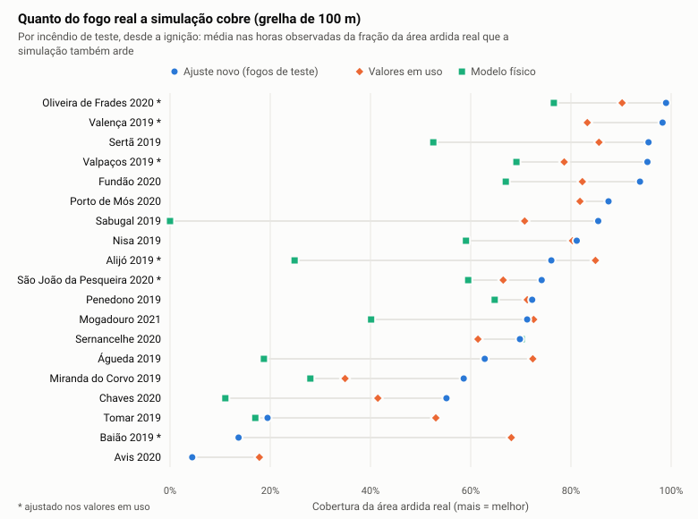
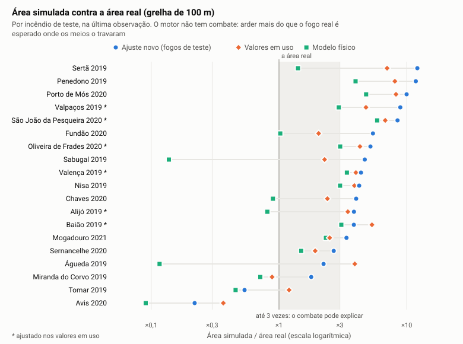
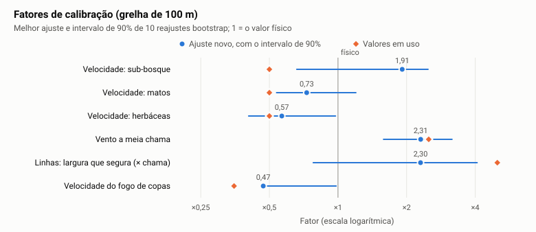

# Como calibramos o motor

Como se ajustam os fatores do motor aos incêndios reais, e porquê assim. Os protocolos completos estão nas ADRs [0068](../decisoes/0068-calibracao-por-cobertura-30-m.md) (30 m) e [0069](../decisoes/0069-recalibracao-da-grelha-de-100-m.md) (100 m). O histórico está em [Calibração e validação](calibracao-e-validacao.md).

## O que se ajusta

O motor usa a física de Rothermel (velocidade do fogo de superfície), de Van Wagner e de Cruz (fogo de copas) e de Sardoy (focos secundários). A calibração não muda essas equações. Ajusta seis fatores que absorvem o que a simulação não tem:

| Fator | O que corrige |
| --- | --- |
| Velocidade do sub-bosque, dos matos e das herbáceas | Combustíveis que diferem do seu modelo, e o efeito médio do relevo e da humidade |
| Vento a meia chama | O vento local, que é mais forte e mais rajado do que o da reanálise ERA5 (31 km) |
| Largura que segura uma linha | Estradas e faixas galgadas por calor e faúlhas antes de a chama ter a largura delas |
| Velocidade do fogo de copas | O modelo de Cruz, feito para pinhais, aplicado também ao eucaliptal |

Cada grelha (100 m e 30 m) tem a sua calibração (`calibrationFor` em `engine/src/calibration.ts`). Os efeitos da resolução (estradas mais largas, caminhos menos flexíveis) não passam de uma para a outra.

## Os incêndios

- **Fonte:** os 80 incêndios do [PT-FireSprd](https://doi.org/10.5281/zenodo.7495506) (Benali et al. 2023), com perímetros observados hora a hora.
- **Reconstrução:** cada um é reconstruído na grelha da calibração com o mesmo código da grelha de Guimarães (`data-prep/build_references.py`). Tem o combustível FUMOD do ano, o relevo, as estradas, o coberto arbóreo e o tempo hora a hora do ERA5.
- **Escolha** (`engine/scripts/fire-selection.ts`), só com os dados e antes de pontuar qualquer modelo:
  - o mapa de combustível é do ano do fogo;
  - há pelo menos um intervalo com 5 ha de área nova;
  - no máximo 25% do que ardeu está em células que o mapa diz não arderem;
  - pelo menos 60% está nos combustíveis que existem em Guimarães.

  Ficam 19 incêndios de 2019 a 2021, os mesmos a 100 e a 30 m.

## O problema: os incêndios reais foram combatidos

O motor simula o fogo **sem combate**. Só há combate onde o utilizador o desenha, para que comparar duas decisões meça só o que se desenhou ([ADR 0057](../decisoes/0057-fogo-sem-combate-e-corridas-rapidas.md)). Os incêndios do PT-FireSprd foram todos combatidos, e o combate não está nos dados.

- **Consequência:** um motor certo deve arder **mais** do que o fogo real onde os meios o travaram.
- **O erro das pontuações simétricas:** o Sørensen e o erro de área contam igual um hectare a mais e um a menos. Um ajuste com elas aprende a imitar o combate, abrandando o fogo.
- **Foi o que aconteceu a 30 m:** o ajuste da [ADR 0064](../decisoes/0064-calibracao-da-grelha-de-30-m.md) ficou com fogos 1,5 vezes maiores do que os reais, que só cobriam 44% do que ardeu.

### A pontuação de cobertura

Em cada intervalo entre duas observações, a simulação recomeça do fogo observado no início do intervalo e compara-se com o que ardeu durante ele:

- **Falhar área custa 4 vezes mais do que arder a mais:** o índice de Tversky, com pesos 0,8 para a área em falta e 0,2 para a área a mais. Com pesos iguais seria o Sørensen.
- **Área em falta:** custa sempre.
- **Área a mais:** só custa acima de 3 vezes a área real e só nos intervalos em que o fogo corria livre. À noite e quando o fogo estava travado, só conta o que falta.
- **Flancos travados:** onde a borda do fogo observado não avançou durante o intervalo, os meios seguraram-na. A área que a simulação arde para lá desses troços não conta. Decide-se só com a observação.
- **A cabeça nas corridas rápidas:** acima de 15 m/min, os meios não seguram o fogo. Aí compara-se a velocidade da cabeça simulada com a observada. Isto impede que "arder tudo" ganhe.

O objetivo de cada fogo soma esta pontuação e 1 − Tversky desde a ignição, que é o que a aplicação mostra.

## O ajuste

- **Algoritmo:** CMA-ES, uma estratégia evolutiva para funções ruidosas sem derivadas. Corre em escala logarítmica, com uma prior fraca para os valores físicos.
- **Dois pontos de partida em cada ajuste:** os valores físicos e o vento ×2. Fica o melhor.
- **Paragem:** o ajuste para quando deixa de melhorar.
- **Velocidade:** todos os ajustes correm ao mesmo tempo, em todos os núcleos. As caches tornam a pontuação 25 a 40% mais rápida sem mudar nenhum número (`engine/scripts/bench-calibration.ts`). O protocolo da ADR 0064 passou de 147 para 115 minutos com o mesmo veredicto.

## Como se decide

- **Validação cruzada em 5 partes:** cada incêndio é pontuado com os fatores ajustados nos outros quatro quintos. É a estimativa do que esperar num incêndio novo.
- **Incerteza:** 10 reajustes em amostras bootstrap dos incêndios dão o intervalo de cada fator.
- **Regra de adoção, fixada antes de correr.** Uma calibração nova substitui a atual só se, nos incêndios de teste emparelhados:
  - o custo descer pelo menos 0,02, com o intervalo de 90% abaixo de 0;
  - a cobertura não descer;
  - a velocidade da cabeça não piorar.

  Num empate fica a atual.
- **Hipóteses estruturais:** por exemplo, um combate de fundo só durante a calibração. Testam-se nas mesmas partes, contra a base, pela mesma regra.

## Reproduzir

```bash
python data-prep/build_references.py --ptfs <PT-FireSprd_v0.08> --cell 100 --out out/reference --manifest out/reference/manifest.json
npx tsx engine/scripts/fire-selection.ts --cases data-prep/out/reference --grid web/public/grids/guimaraes --out engine/reports/selection-100m.json
npx tsx engine/scripts/calibrate.ts --cases ../data-prep/out/reference --select reports/selection-100m.json --incumbent pt \
  --space groupsCrown --fixed crownFire=1 --objective coverageMixed --starts physical,wind2 --seed 1 --bootstrap 10
npx tsx engine/scripts/plot-calibration.ts reports/pt-firesprd-<data>.json ../docs/modelo/calibracao-100m --grid "100 m"
```

## Grelha de 100 m ([ADR 0069](../decisoes/0069-recalibracao-da-grelha-de-100-m.md))

**Resultado: os valores em uso ficam.** Um ajuste novo, com esta pontuação, empata com eles nos incêndios de teste (custo −0,007, intervalo de 90% de −0,091 a +0,081). Os dois cobrem muito mais do fogo real do que o modelo físico.

| Incêndios de teste (19) | Ajuste novo | Valores em uso | Modelo físico |
| --- | --- | --- | --- |
| Cobertura da área ardida real | 0,69 | 0,68 | 0,45 |
| Erro da velocidade da cabeça | 0,62 | 0,64 | 0,78 |
| Área simulada / real (mediana) | ×4,3 | ×3,9 | ×1,5 |
| Custo combinado (menor = melhor) | 1,551 | 1,557 | 1,743 |



- **Sem calibração, o motor perde metade do fogo real** em muitos incêndios (Alijó, Chaves, Águeda, Sabugal). Com o vento a meia chama forte da calibração, chega lá.
- **Avis e Tomar ficam baixos em todas as versões.** Em Baião, o ajuste novo perde o que os valores em uso apanham. A causa destes casos não foi estudada.



- **Calibrado, o motor arde em geral 2 a 8 vezes mais do que o fogo real** (mediana ×3,9 com os valores em uso). Parte disso é combate que o motor não tem: mais de metade da área a mais dos intervalos fica para lá de flancos que os meios seguraram.
- **Parte pode vir do vento forte, que alarga também os flancos.** Os fogos reais pedem uma cabeça mais rápida e flancos mais lentos ([ADR 0057](../decisoes/0057-fogo-sem-combate-e-corridas-rapidas.md)). A forma do fogo é o próximo passo.



- **O vento a meia chama** (×2,3 no ajuste novo, ×2,5 em uso) é a alavanca que mais pesa. Sem ele a cobertura cai de 0,79 para 0,49 nos incêndios do ajuste.
- **O ajuste novo pede o sub-bosque mais rápido e linhas que cedem mais cedo**, mas os intervalos são largos. Com 19 incêndios, não se distingue dos valores em uso.
- **O combate de fundo só na calibração** (a hipótese) empata com a base.

<details>
<summary>Tabela por incêndio (os números dos gráficos)</summary>

Cobertura média nas horas observadas e área simulada sobre a real na última observação, desde a ignição. Cada incêndio é pontuado com o ajuste das outras quatro partes. * = os valores em uso foram ajustados neste incêndio (ADR 0053).

| Incêndio | Cobertura: ajuste novo | em uso | físico | Área / real: ajuste novo | em uso | físico |
| --- | --- | --- | --- | --- | --- | --- |
| Oliveira de Frades 2020 * | 0,99 | 0,90 | 0,77 | ×5,2 | ×4,3 | ×3,0 |
| Valença 2019 * | 0,98 | 0,83 | 0,98 | ×4,4 | ×4,0 | ×3,4 |
| Sertã 2019 | 0,95 | 0,86 | 0,53 | ×12 | ×7,0 | ×1,4 |
| Valpaços 2019 * | 0,95 | 0,79 | 0,69 | ×8,9 | ×4,8 | ×2,9 |
| Fundão 2020 | 0,94 | 0,82 | 0,67 | ×5,4 | ×2,0 | ×1,0 |
| Porto de Mós 2020 | 0,88 | 0,82 | 0,88 | ×10,0 | ×8,2 | ×4,8 |
| Sabugal 2019 | 0,85 | 0,71 | 0,00 | ×4,7 | ×2,3 | ×0,1 |
| Nisa 2019 | 0,81 | 0,80 | 0,59 | ×4,2 | ×3,9 | ×3,0 |
| Alijó 2019 * | 0,76 | 0,85 | 0,25 | ×3,9 | ×3,5 | ×0,8 |
| São João da Pesqueira 2020 * | 0,74 | 0,66 | 0,59 | ×8,5 | ×6,8 | ×5,9 |
| Penedono 2019 | 0,72 | 0,71 | 0,65 | ×12 | ×8,1 | ×4,0 |
| Mogadouro 2021 | 0,71 | 0,73 | 0,40 | ×3,4 | ×2,5 | ×2,3 |
| Sernancelhe 2020 | 0,70 | 0,61 | 0,70 | ×2,7 | ×1,9 | ×1,5 |
| Águeda 2019 | 0,63 | 0,72 | 0,19 | ×2,2 | ×3,9 | ×0,1 |
| Miranda do Corvo 2019 | 0,59 | 0,35 | 0,28 | ×1,8 | ×0,9 | ×0,7 |
| Chaves 2020 | 0,55 | 0,41 | 0,11 | ×4,0 | ×2,4 | ×0,9 |
| Tomar 2019 | 0,19 | 0,53 | 0,17 | ×0,5 | ×1,2 | ×0,5 |
| Baião 2019 * | 0,14 | 0,68 | 0,14 | ×3,9 | ×5,3 | ×3,1 |
| Avis 2020 | 0,04 | 0,18 | 0,04 | ×0,2 | ×0,4 | ×0,1 |

</details>

## Grelha de 30 m ([ADR 0068](../decisoes/0068-calibracao-por-cobertura-30-m.md))

Por correr. O protocolo está registado na ADR 0068.
