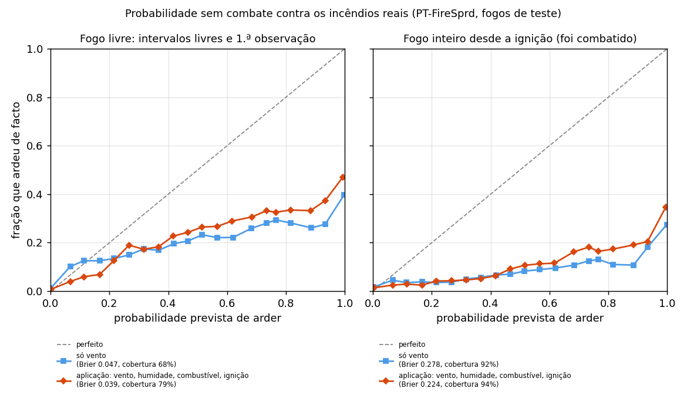

# Incerteza

Como o LinhaZero mede a incerteza e compara as duas decisões cenário a cenário.

## Hoje (feito)

Com "Incerteza" ligada, cada decisão corre **30 vezes com o vento perturbado**, mais uma vez com o vento previsto (`engine/src/simulate.ts`):

- **Perturbação:** a direção varia até ±20° e a velocidade até ±25%, com distribuição uniforme, a partir de uma semente fixa (2035).
- **Mapa principal e métricas** vêm da corrida com o vento previsto; a **probabilidade de arder** de cada célula é a fração das 30 corridas perturbadas em que ela arde dentro da duração ([ADR 0007](../decisoes/0007-ensemble.md)).
- **Vista de incerteza:** os mapas mostram a probabilidade de arder até ao fim da duração; o painel acrescenta a área com probabilidade ≥ 50% ([ADR 0014](../decisoes/0014-vista-de-incerteza.md)).

### Ensemble emparelhado

As decisões A e B correm com a **mesma semente**, por isso a corrida *k* de A e a corrida *k* de B têm exatamente o mesmo vento (números aleatórios comuns, uma técnica clássica de simulação). A comparação faz-se corrida a corrida (`comparePaired`, em `engine/src/metrics.ts`):

- **Em quantos cenários cada decisão é melhor**, para edifícios e para área ardida: *"B poupa 79 edifícios · B é melhor em 27 de 30 cenários"*.
- **Diferença típica:** a mediana das diferenças e o intervalo central de 80% (sem os 10% de corridas mais extremas de cada lado: da 4.ª à 27.ª de 30).
- **Simetria:** trocar A com B só troca o sinal; o resultado não depende de qual decisão se chama A.
- **"Mas":** quando a corrida com o vento previsto e a maioria dos cenários apontam decisões diferentes, a mensagem diz "mas".

Comparar corrida a corrida tira o ruído do vento da diferença. Os simuladores existentes dão mapas de probabilidade para um cenário; não comparam decisões com esta estatística. Ver [ADR 0015](../decisoes/0015-ensemble-emparelhado.md).

**Regra do emparelhamento:** a corrida *k* depende só das opções do ensemble e do vento de base, nunca das intervenções. Qualquer nova variável perturbada tem de manter esta regra (o número de números aleatórios por corrida não pode depender do cenário).

## Cenários sem combate, verificados em incêndios reais

Cada corrida sorteia também a humidade do combustível morto, a velocidade por grupo de combustível e o ponto de ignição, e o vento varia mais (±30°, ±37%). O mapa mostra em quantas corridas cada célula arde, **sem combate além do que se desenhar** ([ADRs 0057](../decisoes/0057-fogo-sem-combate-e-corridas-rapidas.md) e [0058](../decisoes/0058-revisao-do-motor.md)).

- **Como se escolheram as perturbações:** pelo Brier nos fogos de teste, onde o fogo real menos foi travado: nos intervalos em que corria livre e até à primeira observação.
  - Aí o Brier desce de 0,047 (só vento) para 0,039, e a cobertura sobe de 68% para 79% das células que arderam.
  - A escala escolhida ficou no máximo testado, o teto do que se considerou fisicamente plausível.
- **Como se lê:** não é uma probabilidade calibrada. Das células em que todos os cenários ardem, arderam de facto cerca de 47%, e a área com mais de metade dos cenários é 1,3 vezes a real. O motor simula um fogo sem combate, e os fogos reais foram combatidos, mesmo nas primeiras horas.
- **Comparar decisões:** usa as corridas emparelhadas e não muda.
- **Reproduzir:** `npm run reliability -w engine` (cerca de 20 min) escreve `engine/src/calibration-reports/reliability-<data>.json`, e `engine/scripts/plot_reliability.py` desenha a figura.

## Evolução (planeado)

- **Tempo hora a hora:** com passos de tempo, cada corrida aplica o mesmo desvio de direção e o mesmo fator de velocidade a todos os passos (feito). O número de sorteios por corrida não muda.
- **Incerteza da calibração (Rothermel):** o ensemble aceita amostras de parâmetros. A corrida *k* usa a amostra *k* mod *n*, por isso o emparelhamento mantém-se (feito no motor, na interface e no servidor; [ADR 0054](../decisoes/0054-calibracao-por-intervalo-e-por-grupo.md)). A calibração atual não tem amostras: as do bootstrap da calibração por grupo não melhoraram o Brier nos fogos reais (0,080 contra 0,077), por isso não foram adotadas.
- **Mais variáveis perturbadas:** direção e velocidade do vento com correlação temporal (a humidade, a velocidade por combustível e a ignição já variam no Rothermel).
- **Amostragem:** hipercubo latino com semente fixa (resultados reprodutíveis).
- **Mais corridas:** dezenas a centenas, quando o desempenho o permitir ([Requisitos de qualidade](../arquitetura/10-qualidade.md#desempenho)).
- **Saídas novas:** percentis P10/P50/P90 do tempo de chegada a cada ativo; em quantos cenários o fogo chega a cada lugar, com A e com B.

A investigação portuguesa (Benali et al., 2017) mostra que esta incerteza nos dados de entrada pesa mais do que a escolha do modelo (ver [Estado da arte](../estado-da-arte.md)).
