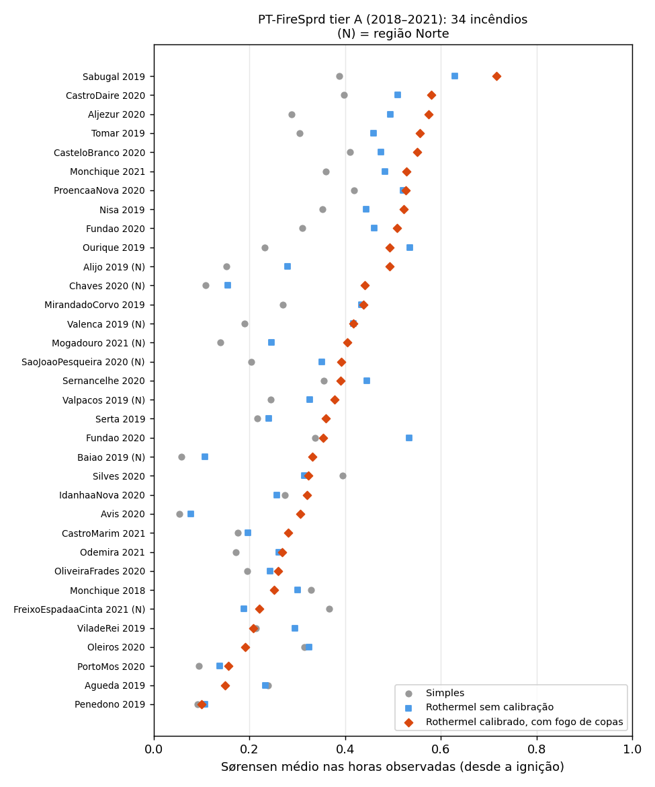

# O motor contra incêndios reais: resumo

Uma página sobre quanto se pode confiar nas simulações, medido em incêndios que aconteceram em Portugal. Os detalhes estão em [Calibração e validação](calibracao-e-validacao.md) e [Incerteza](incerteza.md).

## O que comparámos

- **80 incêndios reais** do [PT-FireSprd](https://doi.org/10.5281/zenodo.7495506) (Benali et al., CC BY 4.0): perímetros observados hora a hora, de 2015 a 2021.
  - **Tier A:** os 34 fogos de 2018–2021 têm o mapa de combustível do próprio ano.
  - **Tier B:** os 46 anteriores só servem para validar.
- **Cada simulação** parte da ignição observada, com o tempo real hora a hora (ERA5) e a humidade do combustível de cada hora, sem combate.
- **Regra de honestidade:** uma mudança no motor só é adotada se melhorar em **fogos que não foram usados para a ajustar** (validação cruzada em 5 partes). Várias ideias foram testadas e rejeitadas por esta regra: humidade por FFMC, ERA5-Land, calibração por grupo de combustível.

## Resultados



Sobreposição entre a área simulada e a área que ardeu de facto (Sørensen médio nas horas observadas; 1 = perfeito). Os fogos reais foram combatidos e a simulação não, por isso o acerto máximo possível fica abaixo de 1:

| | Modelo simples | Rothermel sem calibração | **Rothermel calibrado** |
| --- | --- | --- | --- |
| 34 incêndios de 2018–2021 | 0,25 | 0,34 | **0,38** |
| … dos quais na região Norte (8) | 0,18 | 0,26 | **0,39** |
| 26 incêndios fora do ajuste dos parâmetros principais | 0,26 | 0,35 | **0,38** |

- **Ganho sobre o modelo simples (já retirado da aplicação):** o Rothermel calibrado ganha-lhe em 28 dos 34 incêndios.
- **Ressalva:** os três parâmetros principais nunca foram ajustados nos 26 incêndios de teste, mas algumas escolhas discretas (fogo de copas, limite do vento, tamanho da incerteza) foram decididas a olhar para eles. O número é por isso um pouco otimista.
- **Teste de controlo:** com o vento de cada hora invertido, o acerto cai para metade. A comparação mede de facto alguma coisa.

## Fogo sem combate, e um mapa de cenários verificado


- **O motor simula o fogo sem combate.** Só há combate onde se desenha (Ataque, Linha, Proteger zona), e esse combate perde efeito em fogos intensos. Assim, comparar a decisão A com a B mede só o efeito do que se desenhou.
- **Cada uma das 30 simulações** sorteia o vento, a humidade do combustível, a velocidade por tipo de combustível e o ponto de ignição. O mapa mostra em quantas das simulações cada célula arde, sem combate além do desenhado.
- **Como se escolheu a incerteza:** pela qualidade da probabilidade (Brier) em fogos de teste, onde o fogo real menos foi travado. Aí o Brier desce de 0,047 (só vento) para 0,039, e o mapa avisa 79% das células que arderam (antes 68%).
- **Como se lê:** não é uma probabilidade calibrada. Das células em que todos os cenários ardem, arderam de facto 47%, porque os incêndios reais foram combatidos, e mesmo nas horas em que corriam livres o ataque inicial já travava partes do fogo.
- **Comparar decisões A e B:** usa as mesmas 30 simulações para as duas (emparelhadas).

## Física

- **Modelo de superfície:** Rothermel (1972) com os modelos de combustível portugueses (Fernandes e Loureiro 2021) e o abrigo das copas.
  - Os testes reproduzem o BehavePlus com menos de 1% de diferença.
- **Combustível:** a humidade vem do tempo de cada hora, pelo NFDRS.
- **Intensidade:** comprimento de chama e intensidade. Os ataques perdem efeito acima de 4000 kW/m, e as estradas e as linhas cedem conforme a largura.
- **Focos secundários:** distâncias de Sardoy, como no ELMFIRE.
- **Fogo de copas:** Van Wagner (1977) e Cruz et al. (2005) nos povoamentos de pinheiro, eucalipto e resinosas.
- **32 direções de propagação:** a velocidade da cabeça não depende do ângulo entre o vento e a grelha ([ADR 0058](../decisoes/0058-revisao-do-motor.md)).

## Ver na aplicação

Os cenários **"Incêndio real: Alijó, 24 jul 2019"** e **"Incêndio real: Vieira do Minho, 10 ago 2016"** (a 16 km de Guimarães) abrem a simulação com a ignição e o tempo reais. O perímetro observado aparece por cima, à hora mostrada na barra de tempo. Onde os meios travaram o fogo real, a simulação sem combate vai mais longe.

## Limites conhecidos

- **Picos subestimados:** nas corridas rápidas, o motor faz cerca de 0,67 da velocidade observada. Era 0,6 antes de corrigir as direções de propagação ([ADR 0058](../decisoes/0058-revisao-do-motor.md)).
  - Testámos também recalibrar só no fogo livre, usar as rajadas e mudar o limite do vento ([ADR 0057](../decisoes/0057-fogo-sem-combate-e-corridas-rapidas.md)); nenhum passou a regra.
  - Os fogos reais pedem uma cabeça mais rápida e flancos mais lentos, e tudo o que acelera a cabeça acelera também o resto.
- **Fogos de 2015–2017:** acertam pouco (0,12), porque o mapa de combustível é de depois do fogo.
- **Dados aproximados:** as copas (altura, densidade) são valores típicos por modelo, e as horas do PT-FireSprd são aproximadas.

## Reproduzir

```bash
python data-prep/build_references.py --ptfs <PT-FireSprd_v0.08>   # os 80 casos (cache: depois corre sem rede)
npm run validate -w engine -- --set all                             # acerto por incêndio
npm run calibrate -w engine                                         # calibração e fogos de teste (~70 min)
npm run reliability -w engine                                       # fiabilidade da probabilidade (~6 min)
npm test                                                            # testes do motor, incluindo 9 incêndios reais
```
